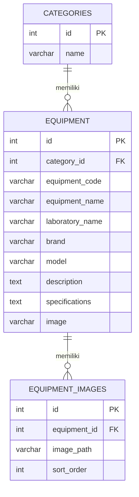

# LABCAT - Laboratory Catalog System

## 1. Deskripsi Sistem

LABCAT adalah sistem katalog digital untuk menampilkan informasi peralatan laboratorium di Fakultas Matematika dan Ilmu Pengetahuan Alam (FMIPA). Pengunjung dapat melihat daftar alat, mencari berdasarkan nama atau kode, memfilter kategori, serta membaca detail dan spesifikasi alat tanpa harus login.

Admin memiliki akses untuk mengelola data alat, kategori, dan foto alat. LABCAT hanya berfungsi sebagai media informasi katalog, bukan sistem peminjaman atau transaksi.

## 2. Bahasa dan Teknologi

- **HTML5**: struktur halaman web.
- **CSS3**: desain dan tata letak halaman.
- **JavaScript**: interaksi antarmuka.
- **PHP**: pemrosesan data pada sisi server.
- **MySQL**: penyimpanan data alat, kategori, dan foto.
- **PDO**: koneksi PHP dengan database.
- **Laragon/XAMPP**: server lokal untuk menjalankan aplikasi.

## 3. Panduan Instalasi

1. Instal dan jalankan Laragon atau XAMPP.
2. Salin folder proyek ke direktori server lokal:
   - Laragon: `C:\laragon\www\`
   - XAMPP: `C:\xampp\htdocs\`
3. Jalankan Apache dan MySQL.
4. Buka `http://localhost/phpmyadmin`.
5. Buat database dengan nama `labcat_db`.
6. Impor file database SQL dari proyek.
7. Sesuaikan host, nama database, username, dan password pada `config/database.php`.
8. Sesuaikan `APP_BASE_URL` pada `config/app.php` dengan lokasi folder proyek.
9. Buka aplikasi melalui browser, misalnya `http://localhost/kelompok_02/`.

Pastikan file SQL database tersedia sebelum menjalankan aplikasi. Jika menggunakan nama folder atau konfigurasi server yang berbeda, sesuaikan alamat URL dan `APP_BASE_URL`.

## 4. Panduan Penggunaan

### Pengunjung
1. Buka halaman LABCAT melalui browser.
2. Lihat daftar peralatan yang tersedia pada katalog.
3. Gunakan kolom pencarian untuk mencari nama atau kode alat.
4. Pilih kategori untuk menyaring daftar alat.
5. Klik **Lihat Detail** untuk membaca informasi, deskripsi, spesifikasi, dan melihat foto alat.

Pengunjung dapat mengakses katalog tanpa login.

### Admin
1. Klik tombol **Login Admin**.
2. Masukkan akun admin.
3. Buka menu pengelolaan alat atau kategori.
4. Tambahkan atau ubah informasi alat sesuai kebutuhan.
5. Unggah foto alat dan simpan perubahan.
6. Periksa hasil pembaruan pada halaman katalog.

## 5. Entity Relationship Diagram (ERD)

ERD katalog terdiri dari tiga entitas utama: `categories`, `equipment`, dan `equipment_images`.

**Keterangan relasi:**
- `categories` ke `equipment` adalah **One-to-Many (1:N)**. Satu kategori dapat digunakan oleh banyak alat.
- `equipment` ke `equipment_images` adalah **One-to-Many (1:N)**. Satu alat dapat memiliki beberapa foto.
- `category_id` merupakan foreign key yang menghubungkan alat dengan kategori.
- `equipment_id` merupakan foreign key yang menghubungkan foto dengan data alat.

*Catatan: nama entitas dan atribut ERD perlu dicocokkan kembali dengan struktur database SQL final proyek.*
