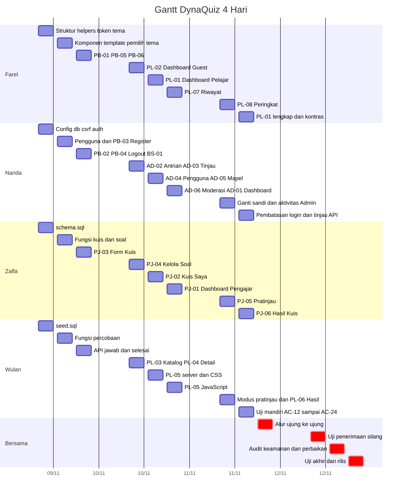

# DynaQuiz: Checklist Jobdesk dan Gantt Chart (4 Hari)

Satu alur utama dari awal sampai rilis. Setiap langkah punya checklist, setiap checklist punya penanggung jawab (PIC), dan langkah berikutnya **baru boleh dimulai setelah GERBANG langkah sebelumnya lolos**.

Sumber: DynaQuiz PRD v0.1. Tim: **Farel**, **Nanda**, **Zalfa**, **Wulan**.

---

## 1. Cara membaca dokumen ini

1. Pekerjaan dibagi menjadi **12 sesi**: 4 hari × 3 sesi (Pagi, Siang, Malam).
2. Di dalam satu sesi, tiap orang mengerjakan itemnya masing-masing **secara paralel**. Nama PIC selalu tertulis di depan item.
3. Di akhir setiap sesi ada **GERBANG**: daftar uji singkat. **Semua kotak gerbang harus tercentang** sebelum sesi berikutnya dimulai.
4. Baris **Butuh:** berarti item itu bergantung pada hasil orang lain. Kalau belum siap, kerjakan item lain dulu atau tanyakan langsung.
5. Jika ada yang selesai lebih cepat, **bantu yang tertinggal** supaya gerbang cepat lolos.
6. Centang `[x]` hanya jika item benar-benar selesai menurut aturan di bawah.

### Aturan "selesai" untuk setiap halaman

- [ ] Semua query memakai PDO prepared statement
- [ ] Semua output lewat `e()` (JavaScript memakai `textContent`)
- [ ] Setiap form POST dan `fetch` membawa token CSRF
- [ ] `wajibPeran()` di baris awal file, dan query berdasarkan `id` selalu menyertakan syarat kepemilikan dan status
- [ ] Tanpa `<script>`, atribut `style`, atau `onclick` inline, dan tanpa aset dari luar
- [ ] Diuji di lebar 360 px dan desktop, pada keempat tema, teks bahasa Indonesia
- [ ] Logika bisnis ada di `includes/fungsi/`, bukan di file halaman

---

## 2. Catatan kapasitas (baca dulu)

Dua puluh tujuh halaman, dua endpoint API, empat tema, dan uji keamanan dalam 4 hari untuk 4 orang adalah **jadwal yang sangat padat**. Rencana ini mengasumsikan 3 sesi kerja per hari, masing-masing sekitar 4 jam. Agar muat:

- Pekerjaan dipecah supaya **tidak ada yang menunggu lama**: Farel menyiapkan UI di Hari 1, Wulan memakai seeder sehingga tidak menunggu alur Pengajar dan Admin.
- Hari 3 sesi 3 dan Hari 4 sepenuhnya dipakai untuk uji silang dan perbaikan. Jangan dipakai menambah fitur.
- Jika terlambat, ada **urutan fitur yang dipotong lebih dulu** (bagian 9).

---

## 3. Kesepakatan awal (15 menit sebelum Sesi 1)

Beberapa hal di PRD belum jelas. Putuskan sekarang supaya tidak menghambat. Semua usulan di bawah adalah bawaan dokumen ini.

- [ ] **Semua** setuju: **Profil (BS-01) untuk Pelajar** memakai template Pelajar (top navbar). Pengajar dan Admin memakai template Panel sidebar
- [ ] **Semua** setuju: **Pratinjau (PJ-05)** menilai jawaban di sisi klien tanpa memanggil API dan tanpa menyimpan apa pun. Kunci boleh ada di halaman karena pemilik kuis berhak melihatnya
- [ ] **Semua** setuju: menjawab soal terakhir **tidak** langsung mengakhiri kuis. Tombol Selesai muncul agar pelajar sempat membaca pembahasan
- [ ] **Semua** setuju: aksi yang mengubah status kuis (Edit, Kelola soal, Ajukan ulang pada kuis Ditolak atau Ditarik) memakai **form POST dengan CSRF**, bukan tautan GET
- [ ] **Semua** setuju: penutupan percobaan saat kuis ditarik (`KT-05`) memakai fungsi milik Wulan, dipanggil di dalam transaksi Zalfa (Tarik oleh Pengajar) dan Nanda (Moderasi oleh Admin)
- [ ] **Semua** setuju: aturan Git. Satu fitur satu cabang, digabung lewat PR yang dilihat minimal satu orang lain, dan `includes/config.local.php` tidak masuk repositori
- [ ] **Semua** menyepakati asumsi jadwal: Hari 1 dimulai tanggal: ____________

### Nama fungsi bersama (jangan diubah tanpa memberi tahu pemakainya)

| Fungsi | Pemilik | Dipakai oleh |
|---|---|---|
| `wajibPeran([...])`, `verifikasiCsrf()`, `e()`, `redirect()`, `flash()` | Nanda dan Farel | Semua |
| `ubahStatusKuis($kuisId, $dari, $ke, $pelaku, $catatan)` | Zalfa | Nanda (Setujui, Tolak, Moderasi) |
| `validasiKelengkapanKuis($kuisId)` | Zalfa | Zalfa (Ajukan publish) |
| `daftarKuisPublik(...)` | Wulan | Farel (PL-02), Wulan (PL-03) |
| `tutupPercobaanKedaluwarsa()` | Wulan | Farel (PL-01, PL-07, PL-08), Wulan (PL-04, PL-05, PL-06) |
| `tutupPercobaanKuis($kuisId)` (untuk `KT-05`) | Wulan | Zalfa (PJ-02), Nanda (AD-06) |
| `jumlahAntrian()` | Nanda | Farel (badge sidebar Admin) |

---

## 4. Alur utama

```
Hari 1                              Hari 2                              Hari 3                              Hari 4
S1 → G1 → S2 → G2 → S3 → G3   →   S4 → G4 → S5 → G5 → S6 → G6   →   S7 → G7 → S8 → G8 → S9 → G9   →   S10 → G10 → S11 → G11 → S12 → G12 (RILIS)
```

| Sesi | Hari | Fokus | Gerbang yang harus lolos |
|---|---|---|---|
| S1 | 1 Pagi | Persiapan proyek, skema DB, seeder, token tema | G1: proyek jalan di semua mesin |
| S2 | 1 Siang | Komponen dan template UI, fungsi inti backend | G2: UI dan fungsi inti siap dipakai |
| S3 | 1 Malam | Halaman publik, login/register, form kuis, API | G3: AC-01, 02, 03, 05, 06, 23, 25 |
| S4 | 2 Pagi | Kelola soal, Admin setujui, Katalog, Detail | G4: kuis dapat dibuat, disetujui, tampil di katalog |
| S5 | 2 Siang | Kuis Saya, Admin pengguna dan mapel, halaman Kerjakan (server dan CSS) | G5: tarik kuis, nonaktif akun, halaman Kerjakan tampil |
| S6 | 2 Malam | Dashboard, Moderasi, Riwayat, JavaScript Kerjakan | G6: satu kuis dapat dikerjakan sampai selesai |
| S7 | 3 Pagi | Pratinjau, Hasil, Peringkat, paksaan ganti sandi | G7: Guest dan Pelajar mendapat hasil |
| S8 | 3 Siang | Hasil Pengajar, dashboard lengkap, pembatasan login, uji mandiri | G8: 27 halaman selesai |
| S9 | 3 Malam | Uji alur ujung ke ujung dan perbaikan | G9: fitur dibekukan |
| S10 | 4 Pagi | Uji penerimaan silang AC-01 sampai AC-27 | G10: semua AC dijalankan |
| S11 | 4 Siang | Audit keamanan silang dan perbaikan bug | G11: tidak ada temuan keamanan terbuka |
| S12 | 4 Malam | Uji tema dan perangkat, performa, README, penyebaran | G12: rilis 1.0 |

---

## 5. Gantt chart

### 5.1 Gantt per orang (tabel, tampil di semua aplikasi)

| Sesi | Farel | Nanda | Zalfa | Wulan | Gerbang |
|---|---|---|---|---|---|
| **S1** H1 Pagi | Repo, struktur folder, `helpers.php`, token tema | `config`, `db`, `csrf`, `auth`, `.htaccess` | `schema.sql` | `seed.sql` | G1 |
| **S2** H1 Siang | Komponen clay, 4 template, pemilih tema | `pengguna.php`, filter Guest, PB-03 Register | `kuis.php`, `soal.php` | `percobaan.php`, `daftarKuisPublik()` | G2 |
| **S3** H1 Malam | PB-01, PB-05, PB-06 | PB-02, PB-04, `logout.php`, BS-01 | PJ-03 Form Kuis | `api/jawab.php`, `api/selesai.php` | G3 |
| **S4** H2 Pagi | PL-02 Dashboard Guest | AD-02 Antrian, AD-03 Tinjau | PJ-04 Kelola Soal, Ajukan publish | PL-03 Katalog, PL-04 Detail | G4 |
| **S5** H2 Siang | PL-01 Dashboard Pelajar (dasar) | AD-04 Pengguna, AD-05 Mapel | PJ-02 Kuis Saya | PL-05 server dan CSS | G5 |
| **S6** H2 Malam | PL-07 Riwayat | AD-06 Moderasi, AD-01 Dashboard | PJ-01 Dashboard Pengajar | `kerjakan.js` | G6 |
| **S7** H3 Pagi | PL-08 Peringkat | Paksaan ganti sandi, aktivitas Admin | PJ-05 Pratinjau | Modus pratinjau, PL-06 Hasil | G7 |
| **S8** H3 Siang | PL-01 lengkap, cek kontras | Pembatasan login, tinjau API | PJ-06 Hasil Kuis | Uji mandiri AC-12 s.d. 18, 24 | G8 |
| **S9** H3 Malam | **Semua**: uji alur ujung ke ujung dan perbaikan bug | | | | G9 |
| **S10** H4 Pagi | **Semua**: uji penerimaan silang AC-01 s.d. AC-27 | | | | G10 |
| **S11** H4 Siang | **Semua**: audit keamanan silang dan perbaikan bug | | | | G11 |
| **S12** H4 Malam | Uji tema, hapus galeri komponen | Penyebaran dan instalasi bersih | Konten 20 kuis, README | Performa, uji perangkat nyata | G12 RILIS |

### 5.2 Gantt visual (tampil bila aplikasi mendukung Mermaid)

Tanggal di sumbu hanya penanda Hari 1 sampai Hari 4. Ganti sesuai jadwal mulai sebenarnya.



---

