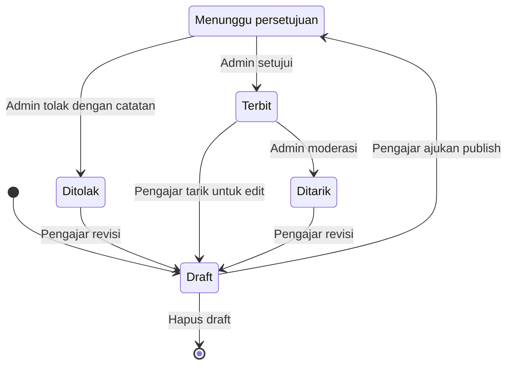
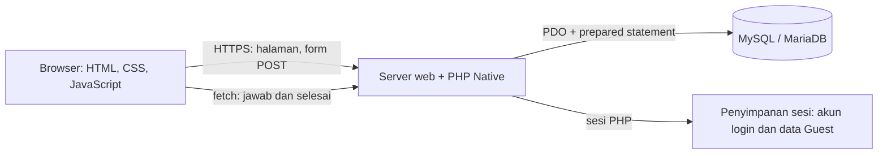
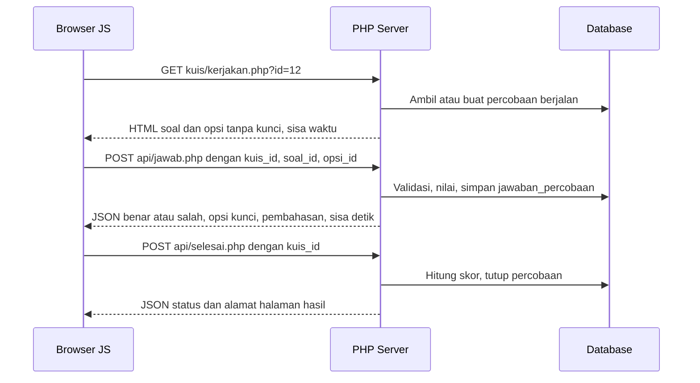
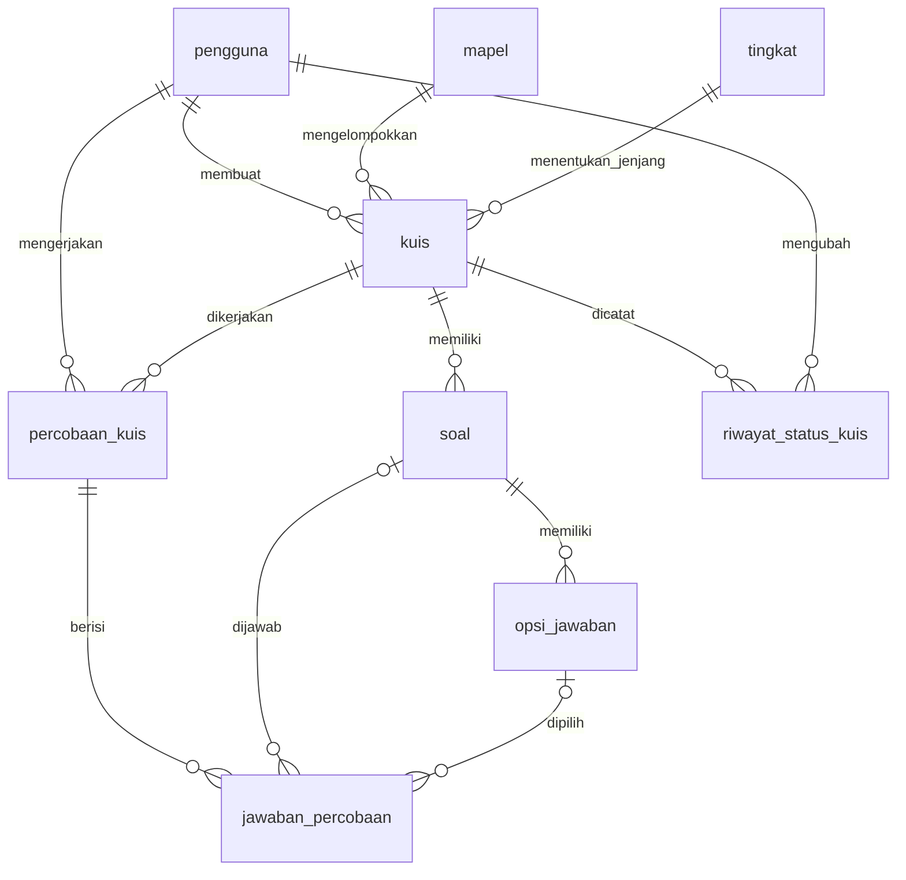

# DynaQuiz: Product Requirements Document (PRD)

**Platform Latihan Soal Interaktif untuk Pelajar**

| | |
|---|---|
| Versi | 0.1 (draft untuk ditinjau) |
| Tanggal | 2 November 2026 |
| Tech stack | HTML, CSS, JavaScript, PHP Native (tanpa framework dan tanpa library pihak ketiga) |
| Penyimpanan data | MySQL atau MariaDB (asumsi, lihat KT-02) |
| Peran pengguna | Guest, Pelajar, Pengajar, Admin |
| Dokumen sumber | User Flow v0.2, Daftar Halaman v0.1, ERD v0.1 |
| Tema default | Sky Bubblegum (tersedia 4 tema, bagian 12) |

PRD ini menggabungkan ketiga dokumen sumber menjadi satu acuan pengembangan. Jika ada perbedaan antara PRD dan dokumen sumber, PRD menjadi acuan setelah disetujui, dan dokumen sumber diperbarui mengikutinya. Hal yang belum diputuskan dikumpulkan di bagian 16 dengan kode **KT-xx** dan dirujuk dari bagian lain.

## Daftar isi

1. Ringkasan produk
2. Latar belakang dan masalah
3. Tujuan, non-tujuan, dan metrik keberhasilan
4. Pengguna dan peran
5. Ruang lingkup
6. Kebutuhan fungsional
7. Aturan bisnis
8. Kebutuhan non-fungsional
9. Arsitektur sistem
10. Model data
11. Daftar halaman dan navigasi
12. Desain UI/UX dan tema
13. Kriteria penerimaan
14. Fase pengembangan
15. Risiko dan mitigasi
16. Keputusan terbuka
17. Glosarium
18. Riwayat perubahan

---

## 1. Ringkasan produk

DynaQuiz adalah website latihan soal interaktif. Pelajar mengerjakan kuis pilihan ganda dengan timer, mendapat umpan balik benar atau salah beserta pembahasan setelah menjawab tiap soal, lalu melihat skor, riwayat, dan peringkat. Pengajar menyusun kuis sendiri. Admin menyetujui setiap kuis sebelum terbit sehingga kualitas katalog terjaga.

**Ciri utama**

| Ciri | Penjelasan |
|---|---|
| Latihan interaktif | Satu soal per layar, umpan balik langsung, pembahasan per soal |
| Timer yang adil | Sisa waktu dihitung di server, refresh halaman tidak mengulang timer |
| Empat peran | Guest (coba cepat tanpa akun), Pelajar, Pengajar, Admin |
| Kurasi konten | Kuis baru terbit setelah disetujui admin saat pengajuan publish |
| Akses fleksibel | Kuis publik muncul di katalog, kuis privat dibuka lewat kode |
| Tampilan Claymorphism | Empat tema warna pastel, mobile-first |

**Prinsip produk**

1. **Server yang menentukan.** Penilaian, sisa waktu, hak akses, dan perubahan status selalu diputuskan PHP. JavaScript hanya mengatur tampilan.
2. **Aman sejak awal.** PHP Native tidak membawa perlindungan bawaan, sehingga CSRF, XSS, SQL injection, dan pengecekan kepemilikan data diperlakukan sebagai kebutuhan, bukan tambahan.
3. **Sederhana untuk dibangun dan dirawat.** Tidak ada framework, tidak ada versi ganda kuis, tidak ada email. Fitur yang menambah kerumitan besar ditunda ke versi berikutnya.
4. **Nyaman di HP.** Halaman Kerjakan Kuis adalah halaman paling kritis dan diuji pertama di layar kecil.

---

## 2. Latar belakang dan masalah

Pelajar membutuhkan latihan soal yang bisa dikerjakan kapan saja dengan umpan balik langsung, bukan hanya kunci jawaban di akhir. Pengajar membutuhkan cara menyusun kuis, membagikannya (ke semua orang atau hanya lewat kode), dan melihat soal mana yang paling sering salah. Sementara itu, jika siapa pun bisa menerbitkan kuis tanpa tinjauan, kesalahan kunci jawaban dan konten tidak pantas akan langsung sampai ke pelajar.

| Masalah | Cara DynaQuiz menjawabnya |
|---|---|
| Latihan soal tersebar dan tidak punya pembahasan | Katalog kuis per mapel dan tingkat, pembahasan di tiap soal |
| Pelajar tidak tahu posisi belajarnya | Skor, riwayat percobaan, dan peringkat |
| Mencoba platform harus daftar dulu | Mode Guest tanpa akun, dengan ajakan daftar di akhir |
| Pengajar tidak tahu soal mana yang sulit | Halaman hasil dengan daftar soal tersulit |
| Kesalahan kunci jawaban merugikan pelajar | Admin meninjau soal, kunci, dan pembahasan sebelum terbit |
| Kuis hanya untuk kelompok tertentu | Akses privat dengan kode kuis |

---

## 3. Tujuan, non-tujuan, dan metrik keberhasilan

### 3.1 Tujuan

1. Pelajar dan Guest dapat memilih kuis, mengerjakannya sampai selesai, dan melihat hasil tanpa bantuan.
2. Pengajar dapat membuat kuis dari draft sampai terbit, dan mengetahui status serta alasan penolakan tanpa bertanya ke admin.
3. Admin dapat menyetujui atau menolak pengajuan, memoderasi kuis terbit, dan mengelola pengguna serta data master dari satu panel.
4. Sistem berjalan dengan HTML, CSS, JavaScript, dan PHP saja, dapat dipasang di hosting PHP biasa.
5. Seluruh halaman nyaman dipakai di layar 360 px sampai desktop, dalam empat tema warna.

### 3.2 Non-tujuan (versi 1.0)

- Bukan platform ujian resmi atau pengawasan ketat (tidak ada anti-curang tingkat proctoring).
- Bukan sistem kelas atau penugasan guru ke murid.
- Bukan sistem pembayaran atau langganan.
- Tidak mengirim email dalam bentuk apa pun.

Daftar lengkap fitur yang ditunda ada di bagian 5.2.

### 3.3 Metrik keberhasilan

Semua metrik dapat dihitung langsung dari tabel pada ERD, tanpa alat analitik tambahan. Target di bawah adalah **usulan** dan perlu dikalibrasi setelah ada data nyata.

| Metrik | Definisi dan sumber data | Target usulan |
|---|---|---|
| Rasio penyelesaian | `percobaan_kuis` berstatus `selesai` atau `waktu_habis` dibagi semua percobaan yang dimulai | ≥ 80% |
| Waktu persetujuan | Selisih waktu baris `draft` ke `menunggu` dengan keputusan berikutnya di `riwayat_status_kuis` (median) | ≤ 2 hari kerja |
| Persetujuan pertama | Persentase pengajuan yang langsung `terbit` tanpa pernah `ditolak` | ≥ 70% |
| Pelajar aktif mingguan | Pelajar berbeda dengan minimal 1 percobaan dalam 7 hari | Dicatat dulu, target ditetapkan setelah 4 minggu data |
| Pelajar kembali | Persentase pelajar dengan percobaan pada ≥ 2 hari berbeda dalam 14 hari | ≥ 40% |
| Kuis terbit | Jumlah kuis berstatus `terbit` | ≥ 20 saat peluncuran (termasuk kuis contoh dari seeder) |

Konversi Guest menjadi Pelajar **tidak dapat diukur** karena data Guest tidak disimpan (lihat KT-13).

---

## 4. Pengguna dan peran

| Peran | Siapa | Tujuan utama | Yang dibutuhkan dari sistem |
|---|---|---|---|
| Guest | Calon pengguna yang ingin mencoba | Mengerjakan satu atau dua kuis tanpa daftar | Masuk cepat dengan username, hanya kuis publik, hasil tampil sementara |
| Pelajar | Siswa atau pembelajar mandiri | Berlatih rutin dan melihat perkembangan | Katalog, kode kuis privat, riwayat, peringkat, dashboard |
| Pengajar | Guru atau pembuat soal | Membuat kuis dan memantau hasil | Draft bebas, status pengajuan jelas, statistik per kuis |
| Admin | Pengelola platform | Menjaga mutu konten dan pengguna | Antrian persetujuan, moderasi, kelola pengguna dan data master |

### 4.1 Hak akses

| Fitur | Guest | Pelajar | Pengajar | Admin |
|---|---|---|---|---|
| Kerjakan kuis publik | Ya | Ya | Pratinjau | Pratinjau |
| Kerjakan kuis privat via kode | Tidak | Ya | Pratinjau | Pratinjau |
| Riwayat dan peringkat tersimpan | Tidak | Ya | Tidak | Tidak |
| Buat, edit, dan hapus draft kuis | Tidak | Tidak | Kuis sendiri | Tidak |
| Ajukan publish kuis | Tidak | Tidak | Kuis sendiri | Tidak |
| Setujui atau tolak publish | Tidak | Tidak | Tidak | Ya |
| Tarik kuis yang sudah terbit | Tidak | Tidak | Kuis sendiri | Semua kuis |
| Lihat hasil pelajar | Tidak | Hasil sendiri | Kuis sendiri | Semua kuis |
| Kelola pengguna, mapel, dan tingkat | Tidak | Tidak | Tidak | Ya |

Catatan: hak "Lihat hasil pelajar" untuk Admin pada semua kuis belum punya halaman tersendiri di Daftar Halaman v0.1. Untuk versi 1.0, Admin melihat data kuis lewat Tinjau Kuis (AD-03) dan Moderasi Kuis (AD-06). Halaman hasil khusus Admin ditunda (KT-16).

---

## 5. Ruang lingkup

### 5.1 Termasuk dalam versi 1.0

- Autentikasi: Register, Login, Logout, mode Guest, Profil.
- Katalog kuis, kode kuis privat, detail kuis.
- Pengerjaan kuis (timer, satu soal per layar, umpan balik langsung, auto-submit).
- Hasil, riwayat, peringkat, dan dashboard untuk Pelajar dan Guest.
- Pembuatan kuis pilihan ganda oleh Pengajar, termasuk draft, pengajuan publish, pratinjau, dan statistik hasil.
- Panel Admin: antrian persetujuan, tinjau, kelola pengguna, kelola mapel dan tingkat, moderasi kuis.
- Empat tema warna dengan pemilih tema.
- Total 27 halaman, 1 proses tanpa tampilan (`logout.php`), dan 2 endpoint API.

### 5.2 Di luar lingkup versi 1.0

| Fitur | Alasan ditunda |
|---|---|
| Lupa password lewat email, notifikasi email | Belum ada pengiriman email. Reset sandi dilakukan Admin |
| Jenis soal selain pilihan ganda satu kunci | Perlu perubahan `opsi_jawaban` dan `jawaban_percobaan` |
| Gambar, lampiran, atau rumus pada soal | Belum ada kolom media dan alur unggah berkas |
| Mode ujian (umpan balik di akhir) | Dicatat sebagai fitur lanjutan di User Flow |
| Acak urutan soal atau opsi | Butuh penyimpanan urutan acak per percobaan agar refresh aman |
| Versi kuis (menyimpan dua versi soal) | Terlalu rumit untuk PHP Native, diganti aturan tarik ke draft |
| Kelas, grup, dan penugasan | Di luar tujuan produk saat ini |
| Impor dan ekspor soal (misalnya CSV) | Kandidat fitur versi berikutnya |
| Statistik Guest | Guest tidak disimpan di database |
| Mode gelap, bahasa selain Indonesia | Belum diminta |
| Halaman bantuan, tentang, kebijakan privasi | Belum termasuk daftar halaman (lihat KT-10) |

---

## 6. Kebutuhan fungsional

Prioritas: **M** (Must, wajib untuk rilis 1.0), **S** (Should, penting dan dikerjakan setelah M selesai), **C** (Could, opsional). Kolom Halaman merujuk ID di Daftar Halaman v0.1.

### 6.1 Autentikasi dan akun (AUT)

| ID | Kebutuhan | Prioritas | Halaman |
|---|---|---|---|
| AUT-01 | Register dengan nama lengkap, email, password, konfirmasi password, dan peran (Pelajar atau Pengajar). Email berformat benar dan belum terdaftar, password minimal 8 karakter, konfirmasi harus sama, error tampil per kolom. Password disimpan dengan `password_hash()`. Akun langsung aktif lalu pengguna diarahkan ke Login. Peran Admin tidak ada di form | M | PB-03 |
| AUT-02 | Login dengan email dan password memakai `password_verify()`. Gagal: pesan umum "Email atau password salah". Akun nonaktif: pesan bahwa akun dinonaktifkan admin. Berhasil: `session_regenerate_id(true)` lalu diarahkan ke dashboard sesuai peran | M | PB-02 |
| AUT-03 | Masuk sebagai Guest dengan username kustom 3 sampai 20 karakter (huruf, angka, spasi, underscore) yang lolos filter kata tidak pantas. Username hanya ada di sesi PHP | M | PB-04 |
| AUT-04 | Logout menghapus sesi dan seluruh data Guest, lalu kembali ke Landing | M | `logout.php` |
| AUT-05 | Setiap halaman dan endpoint memeriksa sesi dan peran di sisi server. Belum login diarahkan ke Login, peran tidak sesuai menghasilkan 403, data tidak ada menghasilkan 404 | M | Semua |
| AUT-06 | Pengguna yang sudah login dan membuka Landing, Login, atau Register diarahkan ke dashboard-nya. Sesi kedaluwarsa diarahkan ke Login | M | PB-01 s.d. PB-03 |
| AUT-07 | Status akun diperiksa pada setiap permintaan terautentikasi. Akun yang dinonaktifkan Admin dikeluarkan pada permintaan berikutnya, bukan menunggu sesi habis | M | `auth.php` |
| AUT-08 | Profil: ubah nama, ganti password (wajib mengisi password lama), email dan peran tampil read-only. Guest diarahkan ke Dashboard Guest | M | BS-01 |
| AUT-09 | Pengguna dengan `wajib_ganti_sandi = 1` diarahkan ke Profil dan tidak dapat membuka halaman lain sampai sandi diganti | S | BS-01 |
| AUT-10 | Pembatasan percobaan login gagal untuk menahan tebak password (lihat KT-07) | S | PB-02 |

### 6.2 Katalog dan detail kuis (KAT)

| ID | Kebutuhan | Prioritas | Halaman |
|---|---|---|---|
| KAT-01 | Katalog hanya menampilkan kuis berstatus **Terbit** dengan akses **publik**, diurutkan dari yang terbaru. Kuis privat tidak pernah tampil di katalog | M | PL-03 |
| KAT-02 | Pencarian berdasarkan judul, filter mapel dan tingkat, pagination (12 kartu per halaman, usulan). Kartu menampilkan judul, mapel, jumlah soal, dan durasi | M | PL-03 |
| KAT-03 | Pelajar memasukkan kode kuis untuk membuka kuis privat. Kode salah atau kuis tidak berstatus Terbit menghasilkan pesan umum yang sama. Input kode tidak tampil untuk Guest | M | PL-03 |
| KAT-04 | Detail kuis menampilkan judul, deskripsi, mapel, tingkat, jumlah soal, durasi, nama pengajar, skor terbaik sebelumnya (Pelajar), dan tombol Mulai. Jika ada percobaan berjalan, tombol berubah menjadi Lanjutkan | M | PL-04 |
| KAT-05 | Hanya kuis berstatus Terbit yang dapat dibuka di PL-03 sampai PL-05, selain itu 404. Akses kuis privat mengikuti BR-12 | M | PL-03 s.d. PL-05 |

### 6.3 Pengerjaan kuis (KRJ)

| ID | Kebutuhan | Prioritas | Halaman |
|---|---|---|---|
| KRJ-01 | Saat Mulai, Pelajar mendapat baris `percobaan_kuis` baru (`waktu_mulai` dari server, `skor_maksimal` dicatat saat itu). Guest mendapat catatan percobaan di sesi PHP. Jika sudah ada percobaan berjalan pada kuis yang sama, percobaan itu dilanjutkan | M | PL-05 |
| KRJ-02 | Mode fokus tanpa navbar: timer, progress bar, kartu soal satu per layar, pilihan jawaban, umpan balik benar atau salah dengan pembahasan singkat, grid nomor soal, tombol Lanjut dan Selesai, konfirmasi saat keluar | M | PL-05 |
| KRJ-03 | Sisa waktu dihitung server dari `waktu_mulai` ditambah durasi. Timer di layar hanya tampilan dan disinkronkan ulang pada setiap respons server. Refresh tidak mengulang timer | M | PL-05 |
| KRJ-04 | Jawaban dikirim per soal lewat `api/jawab.php`. Server menilai jawaban lalu mengembalikan benar atau salah, id opsi kunci, dan pembahasan. HTML awal halaman tidak memuat penanda kunci jawaban | M | PL-05 |
| KRJ-05 | Jawaban yang sudah dikirim terkunci dan tidak dapat diganti, karena umpan balik sudah membuka kunci jawaban | M | PL-05 |
| KRJ-06 | Pengguna dapat berpindah ke nomor soal mana pun lewat grid. Soal yang sudah dijawab dan yang belum ditandai berbeda | M | PL-05 |
| KRJ-07 | Kuis selesai jika semua soal terjawab, pengguna menekan Selesai (dengan konfirmasi bila masih ada soal kosong), atau waktu habis (kirim otomatis). `api/selesai.php` menghitung skor di server lalu mengarahkan ke Hasil | M | PL-05 |
| KRJ-08 | Menutup halaman tidak mengakhiri percobaan. Pelajar dapat melanjutkan dari Detail Kuis atau Dashboard selama waktu belum habis. Jawaban yang sudah terkirim tetap tersimpan | M | PL-01, PL-04 |
| KRJ-09 | Percobaan berjalan yang melewati batas waktu ditutup otomatis menjadi `waktu_habis` pada akses berikutnya (BR-09), dan opsional oleh skrip terjadwal | M | Semua yang membaca percobaan |
| KRJ-10 | Seorang Pelajar hanya memiliki satu percobaan berjalan per kuis | M | PL-05 |

### 6.4 Hasil, riwayat, peringkat, dan dashboard (HSL)

| ID | Kebutuhan | Prioritas | Halaman |
|---|---|---|---|
| HSL-01 | Halaman Hasil: skor, jumlah benar dan salah, waktu pengerjaan, pembahasan per soal (teks soal, jawaban pengguna, kunci, pembahasan), tombol Ulangi, Kuis lain, dan Dashboard | M | PL-06 |
| HSL-02 | Hasil Guest dibaca dari sesi dan disertai ajakan daftar. Hasil hilang saat sesi berakhir | M | PL-06 |
| HSL-03 | Riwayat Pelajar: daftar percobaan (kuis, skor, tanggal, status), filter mapel dan tanggal, pagination, tautan ke Hasil dan ke Detail Kuis untuk mengulang | M | PL-07 |
| HSL-04 | Peringkat: papan peringkat, filter mapel, posisi pengguna disorot. Rumus mengikuti KT-03 | S | PL-08 |
| HSL-05 | Dashboard Pelajar: rata-rata skor, kuis terakhir dengan tombol Lanjutkan jika masih berjalan | M | PL-01 |
| HSL-06 | Dashboard Pelajar: streak, rekomendasi kuis, dan cuplikan peringkat (definisi di KT-06) | S | PL-01 |
| HSL-07 | Dashboard Guest: sapaan dengan username, pilihan kuis publik, banner ajakan daftar, catatan bahwa hasil tidak tersimpan | M | PL-02 |

### 6.5 Pengajar (PJR)

| ID | Kebutuhan | Prioritas | Halaman |
|---|---|---|---|
| PJR-01 | Dashboard: jumlah kuis per status, badge hasil persetujuan terbaru beserta catatan penolakan, ringkasan total percobaan dan rata-rata skor | M | PJ-01 |
| PJR-02 | Kuis Saya: daftar kuis dengan badge status, filter status, dan aksi sesuai status (tabel 7.1) | M | PJ-02 |
| PJR-03 | Buat dan edit kuis sebagai draft: judul, deskripsi, mapel, tingkat, durasi, jenis akses. Kode kuis dibuat otomatis untuk kuis privat | M | PJ-03 |
| PJR-04 | Kelola soal: tambah, ubah, hapus soal, 2 sampai 5 opsi (A sampai E) dengan tepat satu kunci, pembahasan, poin, ubah urutan, dan indikator kelengkapan | M | PJ-04 |
| PJR-05 | Ajukan publish setelah lolos validasi kelengkapan (BR-05). Status menjadi Menunggu persetujuan dan kuis dikunci | M | PJ-04 |
| PJR-06 | Tarik kuis Terbit ke Draft untuk diedit, dengan catatan opsional | M | PJ-02 |
| PJR-07 | Edit, Kelola soal, atau Ajukan ulang pada kuis Ditolak atau Ditarik, mengikuti BR-04 (lihat KT-15) | M | PJ-02 |
| PJR-08 | Hapus draft selama kuis belum pernah dikerjakan | M | PJ-02 |
| PJR-09 | Pratinjau kuis milik sendiri pada status apa pun, dengan tampilan sama seperti Kerjakan Kuis, banner "Mode pratinjau", dan hasil tidak disimpan | M | PJ-05 |
| PJR-10 | Hasil kuis: jumlah percobaan, rata-rata, nilai tertinggi dan terendah, tabel nilai pelajar (nama, skor, persen, waktu, tanggal), dan daftar soal tersulit berdasarkan persentase salah | M | PJ-06 |

### 6.6 Admin (ADM)

| ID | Kebutuhan | Prioritas | Halaman |
|---|---|---|---|
| ADM-01 | Dashboard: jumlah pengguna per peran, jumlah kuis per status, angka antrian persetujuan dengan tautan, aktivitas terbaru | M | AD-01 |
| ADM-02 | Antrian persetujuan: daftar kuis berstatus Menunggu (judul, pengajar, mapel, jumlah soal, tanggal diajukan), terlama di atas. Sidebar menampilkan badge jumlah antrian | M | AD-02 |
| ADM-03 | Tinjau kuis: detail dan seluruh soal dengan kunci tersorot serta pembahasan. Setujui (catatan opsional) atau Tolak (catatan wajib). Status diperiksa ulang saat keputusan disimpan | M | AD-03 |
| ADM-04 | Kelola pengguna: tabel, filter peran dan status, pencarian, aktifkan, nonaktifkan | M | AD-04 |
| ADM-05 | Reset sandi: sistem membuat sandi sementara acak, ditampilkan **satu kali** kepada Admin untuk disampaikan manual, dan `wajib_ganti_sandi` diset 1 | M | AD-04 |
| ADM-06 | Kelola mapel dan tingkat: tambah, ubah, hapus. Hapus ditolak jika masih dipakai kuis. Tingkat memiliki kolom urutan | M | AD-05 |
| ADM-07 | Moderasi: daftar kuis Terbit dengan filter mapel dan pengajar, tombol Tarik dengan alasan wajib, tab kuis berstatus Ditarik | M | AD-06 |
| ADM-08 | Admin tidak dapat menonaktifkan akunnya sendiri | M | AD-04 |

### 6.7 Tema dan antarmuka (TMA)

| ID | Kebutuhan | Prioritas | Halaman |
|---|---|---|---|
| TMA-01 | Empat tema: Lavender Dream, Mint Cloud, Peach Pop, Sky Bubblegum. Default: Sky Bubblegum | M | Semua |
| TMA-02 | Pemilih tema tersedia di semua template layout. Pilihan tersimpan di perangkat dan diterapkan sebelum halaman tampil agar tidak berkedip | M | Semua |
| TMA-03 | Tampilan mobile-first, berfungsi penuh mulai lebar 360 px | M | Semua |
| TMA-04 | Komponen Claymorphism konsisten di semua halaman (bagian 12) | M | Semua |

---

## 7. Aturan bisnis

### 7.1 Siklus status kuis



| Status | Arti | Di katalog | Pengajar dapat | Admin dapat |
|---|---|---|---|---|
| Draft | Sedang disusun atau direvisi | Tidak | Edit, Kelola soal, Pratinjau, Ajukan publish, Hapus | Tidak ada |
| Menunggu persetujuan | Menunggu keputusan, kuis dikunci | Tidak | Pratinjau dan lihat saja | Tinjau, Setujui, Tolak |
| Terbit | Dapat dikerjakan sesuai jenis akses | Ya (publik) | Lihat hasil, Pratinjau, Tarik ke draft | Tarik (moderasi) |
| Ditolak | Ditolak dengan catatan | Tidak | Lihat catatan, Edit, Kelola soal, Ajukan ulang | Tidak ada |
| Ditarik | Dikeluarkan karena moderasi | Tidak | Lihat alasan, Edit, Ajukan ulang | Tidak ada |

Setiap perubahan status menambah satu baris `riwayat_status_kuis` dengan aturan catatan sebagai berikut. Pembuatan draft awal tidak dicatat.

| Aksi | Perubahan | Pelaku | Catatan |
|---|---|---|---|
| Ajukan publish | `draft` ke `menunggu` | Pengajar | Opsional |
| Setujui | `menunggu` ke `terbit` | Admin | Opsional, `diterbitkan_pada` diisi |
| Tolak | `menunggu` ke `ditolak` | Admin | **Wajib** |
| Revisi kuis ditolak | `ditolak` ke `draft` | Pengajar | Kosong |
| Tarik untuk edit | `terbit` ke `draft` | Pengajar | Opsional |
| Moderasi | `terbit` ke `ditarik` | Admin | **Wajib** |
| Revisi kuis ditarik | `ditarik` ke `draft` | Pengajar | Kosong |

### 7.2 Daftar aturan

| ID | Aturan |
|---|---|
| BR-01 | Pengajar bebas membuat, mengedit, dan menyimpan draft tanpa persetujuan admin. Persetujuan hanya terjadi saat publish |
| BR-02 | Kuis berstatus Menunggu atau Terbit tidak dapat diubah, termasuk soal dan opsinya, meskipun URL dibuka langsung. Pemeriksaan ada di sisi server |
| BR-03 | Pengajar hanya dapat mengakses kuis miliknya. Kuis milik pengajar lain menghasilkan 403. Pelajar hanya dapat membuka percobaan miliknya |
| BR-04 | Aksi Edit, Kelola soal, atau Ajukan ulang pada kuis Ditolak atau Ditarik lebih dulu memindahkan kuis ke Draft (satu baris riwayat). Ajukan ulang tanpa perubahan mencatat dua baris (`ditolak` ke `draft`, lalu `draft` ke `menunggu`) dalam satu transaksi |
| BR-05 | Syarat Ajukan publish: judul, mapel, tingkat, dan durasi terisi. Minimal 1 soal. Setiap soal punya minimal 2 opsi dan tepat 1 opsi kunci. Kuis privat memiliki kode |
| BR-06 | Kuis hanya dapat dihapus saat Draft dan belum pernah dikerjakan. Pengguna tidak pernah dihapus, hanya dinonaktifkan |
| BR-07 | Skor = jumlah `poin` soal yang dijawab benar. `skor_maksimal` = jumlah poin semua soal saat percobaan dimulai. Nilai persen = skor dibagi skor maksimal dikali 100, dibulatkan ke bilangan bulat |
| BR-08 | Soal yang tidak dijawab dihitung salah (`jumlah_salah` = jumlah soal dikurangi `jumlah_benar`) dan tidak punya baris di `jawaban_percobaan` |
| BR-09 | Batas waktu = `waktu_mulai` + `durasi_menit`. Jawaban diterima sampai batas waktu ditambah toleransi 5 detik (usulan) untuk keterlambatan jaringan. Setelah itu server menolak jawaban dan menutup percobaan sebagai `waktu_habis`. Percobaan berjalan yang sudah lewat batas ditutup saat pengguna berikutnya mengakses Dashboard, Riwayat, Detail, Kerjakan, atau Peringkat |
| BR-10 | Status akhir percobaan: `selesai` jika diakhiri sebelum batas waktu, `waktu_habis` jika ditutup karena batas waktu |
| BR-11 | Jawaban satu soal hanya dapat dikirim sekali per percobaan (UNIQUE `percobaan_id`, `soal_id`). Pengiriman kedua ditolak dengan respons 409 |
| BR-12 | Kuis privat hanya dapat dibuka Pelajar yang memasukkan kodenya pada sesi itu, atau yang sudah memiliki percobaan pada kuis tersebut. Mengetahui `id` kuis saja tidak cukup (lihat KT-04) |
| BR-13 | Kode kuis acak 6 sampai 8 karakter, unik, hanya untuk akses privat. Kode dihasilkan dengan `random_int()` dari karakter yang tidak ambigu (tanpa 0, O, 1, I, l) dan dikosongkan jika akses diubah menjadi publik |
| BR-14 | Guest hanya dapat mengerjakan kuis publik. Seluruh data Guest berada di sesi dan hilang saat logout atau sesi berakhir |
| BR-15 | Peringkat hanya menghitung percobaan berstatus `selesai` atau `waktu_habis` milik Pelajar terdaftar |
| BR-16 | Admin menolak atau menarik kuis dengan catatan wajib. Keputusan Admin diperiksa ulang terhadap status saat ini di dalam transaksi, sehingga dua admin tidak dapat memutuskan kuis yang sama dua kali |
| BR-17 | Sandi sementara hasil reset dibuat sistem, tidak pernah disimpan sebagai teks biasa, dan hanya ditampilkan sekali kepada Admin |
| BR-18 | Nama mapel dan tingkat tidak boleh kembar. Mapel atau tingkat yang masih dipakai kuis tidak dapat dihapus |
| BR-19 | Zona waktu aplikasi dan sesi database adalah Asia/Jakarta (WIB). Semua kolom waktu disimpan dan ditampilkan dalam WIB |

### 7.3 Batas validasi (usulan)

Batas ini ditegakkan di server, dan diulang di formulir (atribut HTML5 dan JavaScript) hanya demi kenyamanan.

| Data | Batas |
|---|---|
| Nama lengkap | 2 sampai 100 karakter |
| Email | Format valid, maksimal 150 karakter |
| Password | Minimal 8 karakter, maksimal 72 byte (batas efektif bcrypt) |
| Username Guest | 3 sampai 20 karakter, `[A-Za-z0-9_ ]` |
| Judul kuis | 3 sampai 150 karakter |
| Durasi kuis | 1 sampai 240 menit |
| Poin per soal | 1 sampai 100, default 10 |
| Opsi per soal | 2 sampai 5, label A sampai E |
| Teks opsi | 1 sampai 255 karakter |
| Catatan penolakan atau penarikan | Wajib, minimal 10 karakter |

---

## 8. Kebutuhan non-fungsional

### 8.1 Keamanan

PHP Native tidak membawa perlindungan bawaan, sehingga seluruh poin berikut wajib ada dan masuk dalam daftar periksa review kode.

| ID | Kebutuhan |
|---|---|
| SEC-01 | **SQL injection.** Seluruh query memakai PDO prepared statement dengan `ATTR_EMULATE_PREPARES = false`. Tidak ada penggabungan input ke string SQL. Nama kolom untuk pengurutan diambil dari daftar putih |
| SEC-02 | **XSS.** Semua output di-escape lewat helper `e()` (`htmlspecialchars` dengan `ENT_QUOTES`, UTF-8). Teks soal, opsi, dan pembahasan diperlakukan sebagai teks biasa, tidak ada HTML dari pengajar. JavaScript merender respons API dengan `textContent`, bukan `innerHTML` |
| SEC-03 | **CSRF.** Token acak per sesi (`random_bytes`), disisipkan di setiap form POST dan dikirim lewat header `X-CSRF-Token` pada fetch, diverifikasi dengan `hash_equals`. Permintaan tanpa token yang valid ditolak 403. `logout.php` menerima GET sesuai Daftar Halaman, risiko logout paksa diterima karena dampaknya rendah |
| SEC-04 | **Sesi.** `session.use_strict_mode=1`, `use_only_cookies=1`, cookie `HttpOnly`, `Secure` (saat HTTPS), `SameSite=Lax`. `session_regenerate_id(true)` saat login. Batas diam (idle timeout) 2 jam (usulan), dan setiap jawaban kuis memperbarui aktivitas sehingga pengerjaan panjang tidak terputus |
| SEC-05 | **Password.** `password_hash()` dengan `PASSWORD_DEFAULT`, `password_needs_rehash()` saat login. Pesan login gagal selalu umum. Password tidak pernah masuk log |
| SEC-06 | **Otorisasi dan IDOR.** `includes/auth.php` menyediakan pemeriksaan peran yang dipanggil di baris awal setiap file. Setiap query berdasarkan `id` menyertakan syarat kepemilikan (`pengajar_id`, `pelajar_id`) dan syarat status |
| SEC-07 | **Kerahasiaan kunci jawaban.** Kolom `opsi_jawaban.benar` tidak pernah dikirim ke browser sebelum soal itu dijawab. Mode pratinjau Pengajar dan halaman Tinjau Admin boleh menampilkan kunci karena pengguna itu berhak melihatnya |
| SEC-08 | **Integritas penilaian.** Browser hanya mengirim `kuis_id`, `soal_id`, dan `opsi_id`. Server memastikan opsi milik soal itu, soal milik kuis itu, lalu menentukan benar atau salah sendiri |
| SEC-09 | **Header.** `X-Content-Type-Options: nosniff`, `X-Frame-Options: DENY`, `Referrer-Policy: same-origin`, dan Content-Security-Policy `default-src 'self'; frame-ancestors 'none'`. Tanpa `<script>` atau atribut `style` inline di HTML (JavaScript boleh mengatur `element.style`), sehingga CSP ketat dapat dipakai. Semua aset dilayani dari domain sendiri |
| SEC-10 | **Konfigurasi.** Kredensial database di `includes/config.local.php` yang tidak masuk repositori. Folder `includes/` dan `database/` tidak dapat diakses lewat web. `display_errors` mati di produksi dan galat ditulis ke berkas log |
| SEC-11 | **Akun admin awal.** Dibuat seeder dengan `wajib_ganti_sandi = 1`, sehingga sandi awal harus diganti pada login pertama |
| SEC-12 | **Redirect aman.** Parameter tujuan redirect hanya menerima jalur internal, tidak URL penuh |
| SEC-13 | **Filter username Guest.** Daftar kata di `includes/kata_terlarang.php`, dicocokkan tanpa membedakan huruf besar kecil setelah spasi dan underscore dihapus |
| SEC-14 | **Data pribadi minimal.** Hanya nama dan email yang dikumpulkan. Pengajar melihat nama pelajar pada hasil kuis, bukan email |
| SEC-15 | **Pembatasan login.** Lihat AUT-10 dan KT-07 |

### 8.2 Performa

| ID | Kebutuhan |
|---|---|
| PRF-01 | Halaman yang dirender server tampil dalam 2 detik pada koneksi 4G umum |
| PRF-02 | `api/jawab.php` merespons di bawah 500 ms pada kondisi normal |
| PRF-03 | Indeks mengikuti ERD bagian 8. Daftar panjang (katalog, riwayat, tabel admin) memakai pagination. Jumlah soal per kuis diambil dengan satu query agregat, bukan query per baris |
| PRF-04 | Target beban awal 100 pengguna aktif bersamaan (asumsi, perlu dikonfirmasi dengan hosting yang dipilih) |
| PRF-05 | Aset ringan: CSS dan JS ditulis sendiri tanpa framework, ikon berupa SVG inline, font dilayani dari server sendiri dalam format woff2 |

### 8.3 Keandalan dan integritas data

| ID | Kebutuhan |
|---|---|
| REL-01 | Perubahan status kuis dan baris `riwayat_status_kuis` ditulis dalam satu transaksi. Penutupan percobaan (hitung skor, ubah status) juga dalam satu transaksi |
| REL-02 | `api/selesai.php` bersifat idempotent: dipanggil dua kali pada percobaan yang sama mengembalikan hasil yang sama, tanpa menghitung ulang |
| REL-03 | Kegagalan jaringan saat menjawab tidak menghilangkan jawaban yang sudah terkirim. Jawaban dianggap tersimpan hanya setelah server membalas |
| REL-04 | Pencadangan database berkala (harian, usulan) menjadi tanggung jawab operasional hosting |
| REL-05 | Galat tak terduga menampilkan halaman ramah (tanpa jejak teknis) dan dicatat di log |

### 8.4 Kompatibilitas

| Aspek | Kebutuhan |
|---|---|
| Browser | Dua versi terbaru Chrome, Edge, Firefox, dan Safari (desktop), serta Chrome Android dan Safari iOS |
| Layar | Lebar 360 px sampai desktop, tanpa scroll horizontal |
| JavaScript | Diperlukan untuk pengerjaan kuis. Halaman lain tetap dapat dipakai tanpa JavaScript (form biasa dengan post-redirect-get). Halaman kuis menampilkan pesan `noscript` |
| PHP | 8.1 atau lebih baru, dengan ekstensi `pdo_mysql` dan `mbstring` (lihat KT-02) |

### 8.5 Aksesibilitas (target WCAG 2.1 AA)

| ID | Kebutuhan |
|---|---|
| ACC-01 | Kontras teks minimal 4.5:1 pada seluruh pasangan warna di keempat tema (hasil pengecekan di bagian 12.3) |
| ACC-02 | Semua fungsi dapat dioperasikan dengan keyboard. Indikator fokus terlihat jelas pada setiap elemen interaktif |
| ACC-03 | Jawaban benar atau salah tidak hanya dibedakan oleh warna: selalu disertai ikon dan teks |
| ACC-04 | Umpan balik jawaban dan sisa waktu kritis (misalnya 1 menit terakhir) diumumkan lewat `aria-live` |
| ACC-05 | Form memiliki `label` terhubung, pesan error terhubung ke kolomnya, dan `<html lang="id">` |
| ACC-06 | Target sentuh minimal 44 × 44 px pada elemen interaktif di layar kecil |
| ACC-07 | Animasi menghormati `prefers-reduced-motion` |

### 8.6 Kemudahan perawatan

| ID | Kebutuhan |
|---|---|
| MNT-01 | Logika bisnis ditaruh di fungsi pada `includes/fungsi/`, bukan di dalam file halaman, supaya aturan seperti penilaian dan perubahan status hanya ada di satu tempat |
| MNT-02 | Penamaan tabel, kolom, dan berkas memakai Bahasa Indonesia sesuai ERD dan Daftar Halaman |
| MNT-03 | `database/schema.sql` dan `database/seed.sql` cukup untuk membangun ulang database dari nol |
| MNT-04 | `README.md` berisi cara instalasi, konfigurasi, menjalankan seeder, dan checklist keamanan |
| MNT-05 | Tidak ada langkah build. Berkas CSS dan JS yang diedit adalah berkas yang dilayani |

### 8.7 Lokalisasi

Antarmuka berbahasa Indonesia. Tanggal ditampilkan dalam format `2 Nov 2026 14:30` dan zona waktu WIB.

---

## 9. Arsitektur sistem

### 9.1 Gambaran umum



Aplikasi berupa halaman PHP yang dirender di server. JavaScript dipakai untuk interaksi (pengerjaan kuis, timer, pemilih tema, tampil-sembunyi password, konfirmasi), bukan untuk merender seluruh halaman.

### 9.2 Batasan tech stack

| Lapisan | Dipakai | Tidak dipakai |
|---|---|---|
| Markup | HTML5 semantik | Template engine |
| Gaya | CSS3 (custom properties, grid, flexbox) | Bootstrap, Tailwind, preprocessor |
| Skrip klien | JavaScript ES2020 murni (fetch, modul) | jQuery, framework SPA, bundler |
| Server | PHP 8.1+ Native, PDO | Laravel, Composer package, ORM |
| Data | MySQL atau MariaDB | |
| Aset luar | Tidak ada. Font, ikon, dan gambar dilayani dari server sendiri | CDN, Google Fonts, pustaka ikon |

### 9.3 Struktur folder

Berdasarkan Daftar Halaman v0.1. Tanda `(+)` menandai tambahan yang diusulkan PRD ini.

```
dynaquiz/
├── index.php                 Landing
├── login.php
├── register.php
├── guest.php
├── logout.php                Proses saja, tanpa tampilan
├── profil.php                Bersama (Pelajar, Pengajar, Admin)
├── 403.php
├── 404.php
├── .htaccess                 (+) Tolak akses ke includes/ dan database/, header keamanan
├── pelajar/                  dashboard.php, riwayat.php, peringkat.php
├── guest/                    dashboard.php
├── kuis/                     katalog.php, detail.php, kerjakan.php, hasil.php
├── pengajar/                 dashboard.php, kuis.php, kuis-form.php, soal.php, pratinjau.php, hasil.php
├── admin/                    dashboard.php, persetujuan.php, tinjau.php, pengguna.php, mapel.php, moderasi.php
├── api/                      jawab.php, selesai.php
├── includes/
│   ├── config.php            Konstanta umum, zona waktu, pengaturan sesi
│   ├── config.local.php      (+) Kredensial database, tidak masuk repositori
│   ├── db.php                Koneksi PDO
│   ├── auth.php              Pengecekan sesi dan peran
│   ├── csrf.php              (+) Buat dan verifikasi token
│   ├── helpers.php           (+) e(), redirect(), flash(), format tanggal
│   ├── kata_terlarang.php    (+) Daftar kata untuk filter username Guest
│   ├── fungsi/               (+) kuis.php, soal.php, percobaan.php, pengguna.php, statistik.php
│   └── partials/             header, footer, navbar, sidebar, pemilih tema
├── database/                 (+) schema.sql, seed.sql
├── cron/                     (+) tutup_percobaan.php (opsional, lihat 9.7)
└── assets/
    ├── css/                  tema.css, dasar.css, komponen.css, halaman khusus
    ├── js/                   tema-init.js, tema.js, kerjakan.js, ui.js
    ├── fonts/                (+) woff2 yang dilayani sendiri
    └── img/
```

### 9.4 Pola eksekusi halaman PHP

Setiap file halaman mengikuti urutan yang sama agar mudah ditinjau:

1. Muat `config.php`, `db.php`, `auth.php`, `helpers.php`, `csrf.php`.
2. Panggil pemeriksaan peran (misalnya `wajibPeran(['pengajar'])`). Gagal berarti redirect ke Login atau 403.
3. Jika metode POST: verifikasi token CSRF, validasi input, jalankan aksi lewat fungsi di `includes/fungsi/` (dalam transaksi bila mengubah lebih dari satu tabel), simpan pesan flash, lalu redirect (post-redirect-get).
4. Jika metode GET: ambil data, termasuk pemeriksaan kepemilikan dan status, lalu render partial header, isi halaman, dan footer.

### 9.5 Endpoint API

Kedua endpoint hanya menerima POST dengan badan JSON dan header `X-CSRF-Token`, dan memakai kontrak yang sama untuk Pelajar dan Guest. Server menemukan percobaan aktif dari `kuis_id` bersama pengguna di sesi (Pelajar: baris di `percobaan_kuis`, Guest: data di sesi), sehingga `id` percobaan tidak perlu dikirim browser.



**`api/jawab.php`**

| Bagian | Isi |
|---|---|
| Permintaan | `{"kuis_id": 12, "soal_id": 87, "opsi_id": 341}` |
| Berhasil (200) | `{"ok": true, "benar": true, "opsi_benar_id": 341, "pembahasan": "...", "terjawab": 4, "total": 10, "sisa_detik": 512}` |
| Sesi habis (401) | `{"ok": false, "kode": "sesi_habis"}` |
| Token atau peran salah (403) | `{"ok": false, "kode": "ditolak"}` |
| Percobaan tidak ada (404) | `{"ok": false, "kode": "percobaan_tidak_ada"}` |
| Sudah dijawab (409) | `{"ok": false, "kode": "sudah_dijawab"}` |
| Waktu habis (410) | `{"ok": false, "kode": "waktu_habis", "redirect": "..."}` |
| Data tidak valid (422) | `{"ok": false, "kode": "data_tidak_valid"}`, misalnya opsi bukan milik soal |

**`api/selesai.php`**

| Bagian | Isi |
|---|---|
| Permintaan | `{"kuis_id": 12}` |
| Berhasil (200) | `{"ok": true, "status": "selesai", "redirect": "kuis/hasil.php?id=..."}`. Status bernilai `selesai` atau `waktu_habis` |
| Galat | Sama seperti `jawab.php` |

Saat halaman Kerjakan dibuka kembali, soal yang sudah dijawab ikut membawa data umpan baliknya (opsi dipilih, benar atau salah, kunci, pembahasan) karena pengguna sudah berhak melihatnya. Soal yang belum dijawab tidak membawa petunjuk apa pun tentang kunci.

Parameter `id` pada `kuis/hasil.php` adalah `percobaan_kuis.id` untuk Pelajar (harus milik pengguna itu) dan `kuis.id` untuk Guest (data dibaca dari sesi).

### 9.6 Data Guest di sesi

Sesuai ERD bagian 6, Guest tidak memiliki baris di database. Struktur yang diusulkan:

```php
$_SESSION['guest'] = ['username' => 'Budi_01'];

$_SESSION['guest_percobaan'][$kuisId] = [
    'waktu_mulai'   => '2026-11-02 14:40:00',
    'durasi_menit'  => 15,
    'skor_maksimal' => 100,
    'jawaban'       => [ $soalId => ['opsi_id' => 341, 'benar' => true] ],
    'status'        => 'berjalan',
];

$_SESSION['guest_hasil'][$kuisId] = [ /* skor, benar, salah, waktu, rincian per soal */ ];
```

### 9.7 Penutupan percobaan yang kedaluwarsa

PHP tidak menjalankan tugas di latar belakang, sedangkan pengguna dapat menutup tab tanpa menyelesaikan kuis. Karena itu percobaan berjalan yang melewati batas waktu ditutup dengan dua cara:

1. **Saat diakses (wajib).** Fungsi `tutupPercobaanKedaluwarsa()` dipanggil di Dashboard, Riwayat, Peringkat, Detail Kuis, dan Kerjakan. Fungsi ini mencari percobaan berjalan yang sudah lewat batas, menghitung skor dari jawaban yang ada, dan menutupnya sebagai `waktu_habis`.
2. **Skrip terjadwal (opsional).** `cron/tutup_percobaan.php` menjalankan fungsi yang sama untuk seluruh pengguna jika hosting mendukung cron, agar Peringkat selalu mutakhir.

### 9.8 Penyebaran (deployment)

- Dokumen root menunjuk ke folder `dynaquiz/`. Folder `includes/` dan `database/` ditolak lewat `.htaccess` (atau dipindah di luar dokumen root bila hosting mengizinkan).
- HTTPS wajib. Konstanta `BASE_URL` di `config.php` mendukung pemasangan di subfolder.
- Urutan instalasi: buat database, jalankan `schema.sql` lalu `seed.sql` (akun admin, mapel, tingkat, dan beberapa kuis contoh), isi `config.local.php`, login admin, ganti sandi.
- Hosting, versi PHP, dan server web belum ditentukan (KT-02). PRD mengasumsikan Apache dan PHP 8.1 atau lebih baru, misalnya XAMPP untuk pengembangan lokal.

---

## 10. Model data

ERD v0.1 adalah sumber kebenaran untuk kamus data, tipe kolom, dan indeks. PRD ini memakainya **tanpa perubahan wajib**. Ringkasan di bawah hanya untuk orientasi.



### 10.1 Tabel

| Tabel | Fungsi | Dipakai terutama oleh |
|---|---|---|
| `pengguna` | Akun Admin, Pengajar, Pelajar | AUT, ADM-04, ADM-05 |
| `mapel`, `tingkat` | Data master untuk katalog dan filter | ADM-06, KAT-02 |
| `kuis` | Kuis beserta status publikasi, akses, dan kode | PJR, ADM, KAT |
| `soal`, `opsi_jawaban` | Isi kuis dan kunci jawaban | PJR-04, KRJ |
| `percobaan_kuis`, `jawaban_percobaan` | Pengerjaan Pelajar dan jawabannya | KRJ, HSL |
| `riwayat_status_kuis` | Jejak perubahan status dan catatan keputusan | PJR-01, ADM-03, ADM-07 |

Peringkat, soal tersulit, dan statistik dashboard tidak punya tabel sendiri. Semuanya dihitung lewat query.

### 10.2 Catatan penerapan

| Hal | Catatan |
|---|---|
| Mengubah urutan soal | Indeks UNIQUE (`kuis_id`, `urutan`) dapat bentrok di tengah proses jika baris diperbarui satu per satu. Lakukan dalam transaksi dengan dua langkah: geser semua urutan ke rentang sementara (misalnya ditambah 1000), lalu tulis urutan akhir |
| Menyimpan soal beserta opsi | Soal dan seluruh opsinya disimpan dalam satu transaksi, dan aplikasi memastikan 2 sampai 5 opsi dengan tepat satu kunci sebelum commit |
| Riwayat setelah soal diubah | Jika `soal_id` pada `jawaban_percobaan` menjadi NULL karena soal dihapus saat revisi, halaman Hasil menampilkan "Soal ini telah diubah oleh pengajar" dan tetap memakai kolom `benar` yang sudah tersimpan (KT-11) |
| Zona waktu | Setiap koneksi PDO menjalankan `SET time_zone = '+07:00'` |
| Charset | `utf8mb4` dan collation `utf8mb4_unicode_ci` |

### 10.3 Perubahan ERD opsional (bergantung keputusan terbuka)

| Perubahan | Terkait | Diperlukan jika |
|---|---|---|
| Tabel `percobaan_login` (email, alamat IP, waktu) | KT-07 | Pembatasan login gagal dipilih |
| Kolom `pengguna.tema` | KT-08 | Preferensi tema disimpan per akun |
| Tabel `percobaan_guest` tanpa relasi ke `pengguna` | KT-13 | Statistik Guest dibutuhkan |
| Kolom `pengguna.terverifikasi` | KT-01 | Verifikasi pengajar sekali dipilih menggantikan persetujuan per kuis |

---

## 11. Daftar halaman dan navigasi

Rincian komponen tiap halaman ada di Daftar Halaman v0.1 dan tidak diulang di sini. Tabel berikut adalah indeks 27 halaman beserta aturan akses.

| ID | Halaman | File | Akses |
|---|---|---|---|
| PB-01 | Landing | `index.php` | Semua (yang sudah login diarahkan ke dashboard) |
| PB-02 | Login | `login.php` | Belum login |
| PB-03 | Register | `register.php` | Belum login |
| PB-04 | Guest | `guest.php` | Belum login |
| PB-05 | Error 403 | `403.php` | Semua |
| PB-06 | Error 404 | `404.php` | Semua |
| PL-01 | Dashboard Pelajar | `pelajar/dashboard.php` | Pelajar |
| PL-02 | Dashboard Guest | `guest/dashboard.php` | Guest |
| PL-03 | Katalog Kuis | `kuis/katalog.php` | Pelajar, Guest |
| PL-04 | Detail Kuis | `kuis/detail.php?id=` | Pelajar, Guest |
| PL-05 | Kerjakan Kuis | `kuis/kerjakan.php?id=` | Pelajar, Guest |
| PL-06 | Hasil Kuis | `kuis/hasil.php?id=` | Pelajar, Guest |
| PL-07 | Riwayat | `pelajar/riwayat.php` | Pelajar |
| PL-08 | Peringkat | `pelajar/peringkat.php` | Pelajar |
| PJ-01 | Dashboard Pengajar | `pengajar/dashboard.php` | Pengajar |
| PJ-02 | Kuis Saya | `pengajar/kuis.php` | Pengajar |
| PJ-03 | Form Kuis | `pengajar/kuis-form.php` | Pengajar (kuis sendiri) |
| PJ-04 | Kelola Soal | `pengajar/soal.php?kuis_id=` | Pengajar (kuis sendiri) |
| PJ-05 | Pratinjau Kuis | `pengajar/pratinjau.php?id=` | Pengajar (kuis sendiri) |
| PJ-06 | Hasil Kuis Pengajar | `pengajar/hasil.php?kuis_id=` | Pengajar (kuis sendiri) |
| AD-01 | Dashboard Admin | `admin/dashboard.php` | Admin |
| AD-02 | Antrian Persetujuan | `admin/persetujuan.php` | Admin |
| AD-03 | Tinjau Kuis | `admin/tinjau.php?id=` | Admin |
| AD-04 | Kelola Pengguna | `admin/pengguna.php` | Admin |
| AD-05 | Kelola Mapel | `admin/mapel.php` | Admin |
| AD-06 | Moderasi Kuis | `admin/moderasi.php` | Admin |
| BS-01 | Profil | `profil.php` | Pelajar, Pengajar, Admin |

Pelajar dan Guest yang belum berhak membuka sebuah halaman diarahkan sesuai aturan di Daftar Halaman bagian 8. Ringkasnya: belum login ke Login, peran tidak sesuai ke 403, kuis tidak tersedia ke 404.

### 11.1 Menu navigasi per peran

| Peran | Tipe | Menu |
|---|---|---|
| Belum login | Navbar sederhana | Logo, Login, Register, pemilih tema |
| Pelajar | Top navbar | Beranda, Katalog, Peringkat, Riwayat, Profil, Logout, pemilih tema |
| Guest | Top navbar | Beranda, Katalog, Daftar, pemilih tema |
| Pengajar | Sidebar | Dashboard, Kuis Saya, Profil, Logout, pemilih tema |
| Admin | Sidebar | Dashboard, Persetujuan (badge antrian), Pengguna, Mapel, Moderasi, Profil, Logout, pemilih tema |

### 11.2 Template layout

| Template | Dipakai oleh | Ciri |
|---|---|---|
| Publik | PB-01 s.d. PB-06 | Navbar sederhana, footer, konten di tengah |
| Pelajar dan Guest | PL-01 s.d. PL-04, PL-06 s.d. PL-08 | Top navbar, konten dalam grid kartu (bento) |
| Mode fokus | PL-05, PJ-05 | Tanpa navbar dan tanpa pemilih tema. Hanya timer, progress, soal, dan tombol keluar |
| Panel sidebar | PJ-01 s.d. PJ-04, PJ-06, AD-01 s.d. AD-06, BS-01 | Sidebar kiri, menjadi menu dropdown di layar kecil |

---

## 12. Desain UI/UX dan tema

### 12.1 Arah visual: Claymorphism

Tampilan seperti tanah liat lunak yang ditimbulkan dari permukaan: bentuk membulat, warna pastel, bayangan lembut yang berlapis, dan elemen yang terasa dapat ditekan. Cocok untuk pelajar karena ramah dan tidak menegangkan, tetapi perlu disiplin pada kontras agar tetap terbaca.

| Ciri | Aturan |
|---|---|
| Sudut | Radius besar: 12 px (kecil), 20 px (tombol, input), 28 px (kartu) |
| Kedalaman | Bayangan luar gelap lembut di bawah kanan, bayangan terang di atas kiri, dan bayangan dalam tipis agar permukaan tampak menggembung |
| Tekan | Tombol yang ditekan memakai bayangan dalam dan bergeser 1 sampai 2 px |
| Layout | Grid kartu bergaya bento di dashboard, jarak antar kartu lega (16 sampai 24 px) |
| Hiasan | Seperlunya. Tidak ada gambar dekoratif berat agar halaman tetap ringan |

### 12.2 Palet empat tema

Sky Bubblegum adalah tema default. Kode warna di bawah diberikan oleh pemilik produk dan dipakai apa adanya.

| Peran | Lavender Dream | Mint Cloud | Peach Pop | **Sky Bubblegum (default)** |
|---|---|---|---|---|
| Latar | `#EFEAFF` | `#E3F6EE` | `#FFEDE0` | `#E4F1FF` |
| Permukaan kartu | `#FAF8FF` | `#F6FFFB` | `#FFF9F5` | `#F7FBFF` |
| Primary | `#A78BFA` | `#6EE7B7` | `#FF9F7A` | `#7CB9FF` |
| Secondary | `#F9A8D4` | `#7DD3FC` | `#FDE68A` | `#F9A8D4` |
| Accent | `#FDE68A` | `#FDE68A` | `#C4B5FD` | `#FCD34D` |
| Teks utama | `#2E1065` | `#064E3B` | `#431407` | `#0B1F4D` |
| Teks sekunder | `#5B4B8A` | `#2F6B57` | `#8A4A2D` | `#3A5287` |

**Pemakaian peran warna**

| Peran | Dipakai untuk |
|---|---|
| Latar | Latar halaman, trek progress bar, latar tabel |
| Permukaan kartu | Kartu, input, modal, panel soal |
| Primary | Tombol utama, isi progress bar, soal terjawab pada grid, elemen terpilih |
| Secondary | Tombol sekunder, ilustrasi dan aksen dekoratif, kartu sorotan |
| Accent | Sorotan kecil: streak, posisi pengguna di peringkat, badge Menunggu, huruf label opsi jawaban, ajakan daftar untuk Guest |
| Teks utama | Judul, isi, teks di atas tombol berwarna, indikator fokus |
| Teks sekunder | Keterangan, label pendukung, teks bantu |

### 12.3 Pengecekan kontras

Rasio kontras WCAG dihitung dari kode warna di atas. Batas lulus: 4.5:1 untuk teks, 3:1 untuk komponen antarmuka dan indikator fokus.

| Pasangan | Lavender Dream | Mint Cloud | Peach Pop | Sky Bubblegum | Hasil |
|---|---|---|---|---|---|
| Teks utama di atas Latar | 12.98 | 8.65 | 13.74 | 13.91 | Lulus |
| Teks utama di atas Kartu | 14.47 | 9.54 | 15.00 | 15.33 | Lulus |
| Teks sekunder di atas Latar | 6.35 | 5.56 | 5.95 | 6.70 | Lulus |
| Teks sekunder di atas Kartu | 7.07 | 6.13 | 6.49 | 7.38 | Lulus |
| Teks utama di atas Primary | 5.60 | 6.38 | 7.82 | 7.77 | Lulus |
| Teks utama di atas Secondary | 8.40 | 5.83 | 12.57 | 8.79 | Lulus |
| Teks utama di atas Accent | 12.23 | 7.80 | 8.48 | 11.06 | Lulus |
| Teks sekunder di atas Primary | 2.74 | 4.10 | 3.39 | 3.74 | **Gagal** |
| Teks sekunder di atas Accent | 5.98 | 5.02 | 3.67 | 5.32 | **Gagal di Peach Pop** |
| Primary di atas Latar | 2.32 | 1.36 | 1.76 | 1.79 | **Gagal** untuk teks dan batas |
| Primary di atas Kartu | 2.58 | 1.50 | 1.92 | 1.97 | **Gagal** untuk teks dan batas |

**Aturan pemakaian yang diturunkan dari hasil di atas**

1. Teks di atas isi Primary, Secondary, atau Accent **selalu memakai Teks utama**. Teks sekunder hanya di atas Latar atau Permukaan kartu.
2. Primary, Secondary, dan Accent **tidak dipakai sebagai warna teks, tautan, atau satu-satunya penanda batas** karena kontrasnya di bawah 3:1 terhadap latar. Batas dan keadaan dibentuk oleh bayangan clay, ikon, dan teks.
3. Indikator fokus keyboard memakai garis 3 px berwarna Teks utama dengan jarak 2 px dari elemen (kontras terhadap Latar di semua tema di atas 8:1).
4. Tautan di dalam teks berwarna Teks utama dan bergaris bawah.

### 12.4 Warna semantik (usulan)

Palet dari pemilik produk belum memuat warna untuk benar, salah, dan status. Warna berikut diusulkan netral terhadap tema dan sudah dicek kontrasnya (lihat KT-09).

| Token | Latar | Teks | Kontras | Dipakai untuk |
|---|---|---|---|---|
| Sukses | `#DCFCE7` | `#14532D` | 8.30 | Jawaban benar, badge Terbit, pesan berhasil |
| Galat | `#FEE2E2` | `#7F1D1D` | 8.20 | Jawaban salah, badge Ditolak, pesan error, tombol berisiko |
| Netral | `#E5E7EB` | `#374151` | 8.33 | Badge Draft dan Ditarik |

Teks Sukses di atas Permukaan kartu berkontras 8.65 sampai 8.94, dan teks Galat 9.51 sampai 9.84, sehingga aman dipakai langsung di atas kartu pada keempat tema. Karena Mint Cloud memakai hijau sebagai Primary, status benar atau salah **tidak boleh bergantung pada warna saja** (ACC-03): selalu ikon centang atau silang beserta kata "Benar" atau "Belum tepat".

### 12.5 Design token

Seluruh warna dan bentuk ditulis sebagai CSS custom property. Tema diganti lewat atribut `data-tema` pada elemen `<html>`.

```css
/* tema.css */
:root,
[data-tema="sky-bubblegum"] {
  --latar: #E4F1FF;  --kartu: #F7FBFF;
  --primary: #7CB9FF; --secondary: #F9A8D4; --accent: #FCD34D;
  --teks: #0B1F4D;   --teks-2: #3A5287;
}
[data-tema="lavender-dream"] {
  --latar: #EFEAFF;  --kartu: #FAF8FF;
  --primary: #A78BFA; --secondary: #F9A8D4; --accent: #FDE68A;
  --teks: #2E1065;   --teks-2: #5B4B8A;
}
[data-tema="mint-cloud"] {
  --latar: #E3F6EE;  --kartu: #F6FFFB;
  --primary: #6EE7B7; --secondary: #7DD3FC; --accent: #FDE68A;
  --teks: #064E3B;   --teks-2: #2F6B57;
}
[data-tema="peach-pop"] {
  --latar: #FFEDE0;  --kartu: #FFF9F5;
  --primary: #FF9F7A; --secondary: #FDE68A; --accent: #C4B5FD;
  --teks: #431407;   --teks-2: #8A4A2D;
}

/* dasar.css */
:root {
  --sukses-bg: #DCFCE7; --sukses-teks: #14532D;
  --galat-bg:  #FEE2E2; --galat-teks:  #7F1D1D;
  --netral-bg: #E5E7EB; --netral-teks: #374151;

  --radius-s: 12px; --radius-m: 20px; --radius-l: 28px;

  --bayangan-gelap: color-mix(in srgb, var(--teks) 22%, transparent);
  --bayangan-terang: rgb(255 255 255 / .85);
  --clay-timbul:
    8px 8px 18px var(--bayangan-gelap),
    -6px -6px 14px var(--bayangan-terang),
    inset -3px -3px 6px color-mix(in srgb, var(--teks) 10%, transparent),
    inset 3px 3px 6px rgb(255 255 255 / .7);
  --clay-tekan:
    inset 5px 5px 10px var(--bayangan-gelap),
    inset -4px -4px 8px var(--bayangan-terang);
}
```

`assets/js/tema-init.js` dimuat sebagai berkas biasa (bukan inline) di `<head>` secara sinkron, sebelum CSS dirender, agar tema tersimpan langsung terpasang tanpa berkedip dan tetap sesuai CSP:

```js
(function () {
  var tema = 'sky-bubblegum';
  try {
    var s = localStorage.getItem('dq-tema');
    if (['lavender-dream', 'mint-cloud', 'peach-pop', 'sky-bubblegum'].indexOf(s) > -1) tema = s;
  } catch (e) { /* penyimpanan diblokir: pakai default */ }
  document.documentElement.setAttribute('data-tema', tema);
})();
```

Preferensi tema disimpan per perangkat di `localStorage` (KT-08), sehingga tidak membutuhkan perubahan database dan berlaku juga untuk Guest.

### 12.6 Tipografi dan ikon (usulan)

| Elemen | Usulan |
|---|---|
| Judul | Fredoka, bobot 600, bentuk bulat selaras dengan Claymorphism |
| Teks isi dan UI | Nunito, bobot 400 dan 700 |
| Sumber | Berkas woff2 subset Latin yang dilayani dari `assets/fonts/` (keduanya berlisensi SIL OFL). Cadangan: `system-ui, sans-serif` |
| Ukuran | Dasar 16 px, skala 1.25. Teks soal di mode fokus minimal 18 px |
| Ikon | SVG inline sendiri, tanpa pustaka ikon |

Pilihan font masih perlu dikonfirmasi (KT-09).

### 12.7 Komponen

| Komponen | Spesifikasi |
|---|---|
| Tombol utama | Isi Primary, teks Teks utama, radius 20 px, `--clay-timbul`. Ditekan: `--clay-tekan` dan geser 1 px. Tinggi minimal 44 px |
| Tombol sekunder | Isi Secondary, bentuk sama |
| Tombol aksen | Isi Accent, untuk ajakan khusus (misalnya Daftar pada banner Guest) |
| Tombol berisiko | Isi Galat, dipakai untuk Tolak, Tarik, Nonaktifkan, Hapus. Selalu lewat dialog konfirmasi |
| Kartu | Permukaan kartu, radius 28 px, `--clay-timbul`. Di dashboard disusun sebagai grid bento |
| Input | Permukaan kartu dengan bayangan masuk, radius 16 px, label di atas kolom, pesan error di bawah kolom disertai ikon |
| Pilihan jawaban | Kartu kecil dengan lingkaran huruf A sampai E berisi Accent. Terpilih: bayangan tekan, tepi 3 px Teks utama, dan ikon radio terisi. Setelah dijawab: benar memakai Sukses dengan ikon centang dan teks "Benar", salah memakai Galat dengan ikon silang dan teks "Belum tepat", dan kunci yang tidak dipilih diberi ikon centang dan teks "Jawaban benar" |
| Timer | Pil dengan ikon jam. Pada 1 menit terakhir berubah ke Accent dan diumumkan lewat `aria-live` |
| Progress bar | Trek berwarna Latar dengan bayangan masuk, isi Primary, disertai teks "Soal 4 dari 10" |
| Grid nomor soal | Tombol bulat 44 px. Belum dijawab: kartu. Sudah dijawab: Primary dengan ikon kecil. Soal aktif: cincin Teks utama |
| Badge status kuis | Pil dengan ikon dan teks. Draft: Netral. Menunggu persetujuan: Accent. Terbit: Sukses. Ditolak: Galat. Ditarik: Netral dengan ikon larangan |
| Tabel | Di layar kecil setiap baris menjadi kartu bertumpuk, di layar 900 px ke atas menjadi tabel biasa |
| Dialog konfirmasi | Elemen `<dialog>`, fokus terkurung di dalam dialog, tutup dengan Esc |
| Pesan flash | Sukses, galat, dan info dengan ikon. `role="status"` untuk info dan sukses, `role="alert"` untuk galat |
| Pemilih tema | Empat swatch bulat (Primary dan Secondary berdampingan) dengan `aria-label` nama tema dan `aria-pressed`. Tidak tampil di mode fokus |

### 12.8 Halaman Kerjakan Kuis (PL-05)

Halaman paling kritis, dirancang dari layar 360 px. Gambaran tata letak seluler:

```
┌────────────────────────────┐
│ ✕ Keluar          ⏱ 12:45  │  baris atas: keluar dan timer
│ ▓▓▓▓▓▓░░░░░░░  Soal 4 / 10│  progress bar
├────────────────────────────┤
│  Teks soal ...             │  kartu soal
│                            │
│  (A) Opsi pertama          │  pilihan jawaban,
│  (B) Opsi kedua            │  satu kartu per opsi
│  (C) Opsi ketiga           │
│  (D) Opsi keempat          │
│                            │
│  ✔ Benar! Pembahasan ...   │  muncul setelah menjawab
├────────────────────────────┤
│  1 2 3 [4] 5 6 7 8 9 10    │  grid nomor soal
│  [        Lanjut        ]  │  tombol utama, lebar penuh
└────────────────────────────┘
```

Perilaku penting:
- Memilih opsi langsung mengirim jawaban. Opsi dikunci selama menunggu server, lalu menampilkan umpan balik.
- Jika pengiriman gagal, tampil pesan "Jawaban belum terkirim" dengan tombol Coba lagi. Jawaban dianggap tersimpan hanya setelah server membalas (REL-03).
- Tombol Keluar membuka dialog konfirmasi. Keluar tidak mengakhiri percobaan.
- Tombol Selesai pada soal terakhir (atau kapan saja lewat menu) menampilkan jumlah soal yang belum dijawab sebelum dikirim.
- Sisa waktu 0 memicu pengiriman otomatis dan pesan "Waktu habis".

### 12.9 Breakpoint dan layout

| Breakpoint | Perilaku |
|---|---|
| Dasar (360 px ke atas) | Satu kolom, sidebar menjadi menu dropdown, tabel menjadi kartu |
| 600 px | Grid kartu dua kolom |
| 900 px | Sidebar tetap di kiri, tabel penuh, grid bento tiga kolom |
| 1200 px | Lebar konten dibatasi sekitar 1140 px dan diletakkan di tengah |

### 12.10 Keadaan antarmuka

| Keadaan | Penanganan |
|---|---|
| Memuat | Tombol berubah menjadi keadaan memuat dan tidak dapat diklik ganda |
| Kosong | Pesan ramah dengan tindakan lanjut, misalnya "Belum ada kuis yang cocok. Coba ubah filter" |
| Galat form | Error di bawah kolom, fokus pindah ke kolom pertama yang salah, data yang sudah diisi tidak hilang (kecuali password) |
| Galat server | Halaman ramah tanpa jejak teknis |
| Sesi habis saat mengerjakan | Dialog meminta login ulang, percobaan tetap berjalan di server |

### 12.11 Gerak dan nada bahasa

- Transisi 150 sampai 250 ms pada tombol, kartu, dan umpan balik. Semua dimatikan atau disederhanakan saat `prefers-reduced-motion`.
- Bahasa antarmuka santai, jelas, dan mendukung. Contoh: "Benar! Lanjut ke soal berikutnya." dan "Belum tepat. Jawaban yang benar: B." Pesan galat menjelaskan apa yang bisa dilakukan, bukan menyalahkan pengguna.

---

## 13. Kriteria penerimaan

Skenario berikut menjadi dasar uji penerimaan rilis 1.0. Setiap skenario ditulis dalam bentuk kondisi awal, tindakan, dan hasil yang diharapkan.

| ID | Kebutuhan terkait | Kondisi awal dan tindakan | Hasil yang diharapkan |
|---|---|---|---|
| AC-01 | AUT-01 | Pengunjung mengisi Register dengan data valid sebagai Pelajar | Akun dibuat dengan status aktif, pengguna diarahkan ke Login, dan dapat langsung login |
| AC-02 | AUT-01 | Register memakai email yang sudah terdaftar atau password kurang dari 8 karakter | Error tampil pada kolom yang salah, tidak ada akun baru |
| AC-03 | AUT-02 | Login dengan email benar dan password salah, lalu dengan email yang tidak terdaftar | Kedua kasus menampilkan pesan yang sama: "Email atau password salah" |
| AC-04 | AUT-02, AUT-07 | Akun nonaktif mencoba login. Akun aktif yang sedang login dinonaktifkan Admin | Percobaan login menampilkan pesan akun dinonaktifkan. Pengguna yang sedang login dikeluarkan pada permintaan berikutnya |
| AC-05 | AUT-05 | Pelajar membuka `admin/dashboard.php` lewat URL. Pengunjung belum login membuka `pelajar/dashboard.php` | Pelajar mendapat 403. Pengunjung diarahkan ke Login |
| AC-06 | AUT-03 | Guest memasukkan username "ab", lalu "Budi_01" | "ab" ditolak. "Budi_01" masuk ke Dashboard Guest tanpa baris baru di `pengguna` |
| AC-07 | PJR-03, PJR-04 | Pengajar membuat kuis dan menambah 3 soal tanpa melibatkan Admin | Kuis tampil di Kuis Saya berstatus Draft dan tidak muncul di katalog |
| AC-08 | PJR-05, BR-02, BR-05 | Pengajar mengajukan kuis tanpa soal, lalu kuis dengan soal tanpa kunci, lalu kuis lengkap | Dua pengajuan pertama ditolak dengan pesan alasan. Yang lengkap berubah menjadi Menunggu. Membuka `kuis-form.php` atau `soal.php` kuis itu lewat URL ditolak |
| AC-09 | ADM-03 | Admin menolak tanpa catatan, lalu dengan catatan | Tanpa catatan ditolak validasi. Dengan catatan status menjadi Ditolak, baris riwayat tercatat, dan Pengajar melihat catatan di dashboard |
| AC-10 | ADM-03, KAT-01 | Admin menyetujui kuis publik | Status Terbit, `diterbitkan_pada` terisi, kuis muncul di katalog |
| AC-11 | BR-16 | Dua Admin membuka kuis yang sama, keduanya memutuskan | Keputusan kedua ditolak dengan pesan bahwa kuis sudah diputuskan, tidak ada baris riwayat ganda |
| AC-12 | KRJ-03, KRJ-08 | Pelajar memulai kuis 10 menit, refresh di menit 3, lalu menutup tab di menit 5 dan membukanya lagi | Setelah refresh sisa waktu sekitar 7 menit. Setelah dibuka lagi percobaan dilanjutkan dengan jawaban sebelumnya tetap ada dan sisa waktu sekitar 5 menit |
| AC-13 | KRJ-04, KRJ-05, SEC-07 | Pelajar membuka soal, memeriksa sumber halaman dan permintaan jaringan sebelum menjawab, lalu menjawab, lalu mengirim jawaban kedua untuk soal yang sama | Sebelum menjawab tidak ada petunjuk kunci di HTML maupun respons. Setelah menjawab umpan balik dan pembahasan tampil. Pengiriman kedua ditolak (409) |
| AC-14 | KRJ-07, BR-07, BR-08 | Pelajar menjawab 6 dari 10 soal (4 benar) lalu waktu habis | Pengiriman otomatis, status `waktu_habis`, skor = jumlah poin 4 soal benar, `jumlah_salah` = 6 |
| AC-15 | KRJ-09, BR-15 | Pelajar menutup tab dan tidak kembali sampai durasi lewat, lalu membuka Dashboard | Percobaan tertutup sebagai `waktu_habis` dengan skor dari jawaban yang ada, tampil di Riwayat, dan ikut dihitung di Peringkat |
| AC-16 | BR-14, HSL-02 | Guest menyelesaikan kuis publik, lalu logout. Guest mencoba membuka kuis privat lewat URL | Hasil tampil dengan ajakan daftar dan tidak ada baris `percobaan_kuis`. Setelah logout hasil hilang. Akses kuis privat ditolak |
| AC-17 | KAT-03, BR-12 | Pelajar memasukkan kode privat yang benar. Pelajar lain membuka `detail.php?id=` kuis privat itu tanpa kode | Pemilik kode membuka Detail. Pelajar lain mendapat 404 |
| AC-18 | BR-03, SEC-06 | Pengajar A membuka `soal.php?kuis_id=` milik Pengajar B. Pelajar membuka `hasil.php?id=` percobaan Pelajar lain | Keduanya ditolak |
| AC-19 | PJR-06 | Pengajar menarik kuis Terbit ke Draft | Kuis hilang dari katalog, baris riwayat tercatat, dan kuis dapat diedit |
| AC-20 | ADM-07 | Admin menarik kuis Terbit tanpa alasan, lalu dengan alasan | Tanpa alasan ditolak. Dengan alasan status menjadi Ditarik dan Pengajar melihat alasannya |
| AC-21 | ADM-05, AUT-09 | Admin mereset sandi seorang pengguna, lalu memuat ulang halaman, lalu pengguna login dengan sandi sementara | Sandi sementara tampil sekali saja dan tidak muncul setelah muat ulang. Pengguna dipaksa mengganti sandi sebelum membuka halaman lain |
| AC-22 | ADM-06, BR-18 | Admin menghapus mapel yang dipakai kuis | Penghapusan ditolak dengan pesan |
| AC-23 | TMA-01, TMA-02 | Pengguna memilih Peach Pop, lalu memuat ulang. Ulangi dengan penyimpanan browser diblokir | Seluruh halaman berganti tema, bertahan setelah muat ulang, dan tidak berkedip. Jika penyimpanan diblokir, tema Sky Bubblegum dipakai tanpa galat |
| AC-24 | TMA-03, ACC-06 | Buka Kerjakan Kuis pada lebar 360 px | Tidak ada scroll horizontal, semua target sentuh minimal 44 px, soal dan opsi terbaca tanpa zoom |
| AC-25 | SEC-03 | Kirim POST ke aksi apa pun tanpa token CSRF atau dengan token salah | Permintaan ditolak 403 dan tidak mengubah data |
| AC-26 | SEC-02 | Pengajar menulis soal berisi `<script>alert(1)</script>` | Teks tampil apa adanya di semua halaman, tidak ada skrip yang berjalan |
| AC-27 | ACC-01 | Periksa semua pasangan teks dan latar pada keempat tema | Seluruhnya mencapai kontras minimal 4.5:1 sesuai aturan pemakaian di 12.3 |

---

## 14. Fase pengembangan

Urutan disusun dari ketergantungan: Pelajar tidak dapat diuji tanpa kuis Terbit, dan kuis Terbit membutuhkan alur Pengajar dan Admin. Estimasi durasi tidak diberikan karena bergantung pada ukuran tim.

| Fase | Cakupan | Keluaran | Selesai bila |
|---|---|---|---|
| 0. Persiapan | Lingkungan pengembangan, repositori, `schema.sql`, `seed.sql` (admin, mapel, tingkat, kuis contoh), `config`, `db`, `auth`, `csrf`, `helpers` | Proyek kosong yang dapat dijalankan dan database terbentuk dari nol | Instalasi mengikuti README berhasil di mesin bersih |
| 1. Fondasi UI dan autentikasi | Token tema, empat template layout, komponen clay, pemilih tema, PB-01 s.d. PB-06, Logout, BS-01, penjaga peran | Pengguna dapat register, login, masuk Guest, ganti tema, dan melihat dashboard kosong sesuai peran | AC-01 sampai AC-03, AC-05, AC-06, AC-23, AC-25 lulus |
| 2. Siklus kuis | PJ-01 s.d. PJ-04, AD-01 s.d. AD-06, riwayat status, kunci kuis saat Menunggu, reset sandi | Kuis dapat dibuat, diajukan, ditinjau, diterbitkan, ditolak, ditarik. Admin dapat menonaktifkan akun | AC-04, AC-07 sampai AC-11, AC-19, AC-20, AC-22 lulus |
| 3. Pengerjaan | PL-02 s.d. PL-06, `api/jawab.php`, `api/selesai.php`, mode fokus, PJ-05 (memakai mode fokus yang sama), PL-01 dasar, penutupan percobaan kedaluwarsa | Pelajar dan Guest dapat mengerjakan kuis dari katalog atau kode sampai hasil | AC-12 sampai AC-18, AC-24, AC-26 lulus |
| 4. Pelengkap | PL-07, PL-08, PL-01 lengkap (streak, rekomendasi, cuplikan peringkat), PJ-06 (hasil kuis dan soal tersulit), aktivitas terbaru Admin, paksaan ganti sandi, pembatasan login | Seluruh 27 halaman berfungsi penuh | Seluruh fitur M dan S pada bagian 6 selesai, AC-21 lulus, dan AC-15 bagian Riwayat dan Peringkat lulus |
| 5. Pengerasan dan rilis | Audit keamanan dengan checklist 8.1, uji seluruh AC, uji keempat tema dan beberapa perangkat nyata, uji performa, konten contoh, dokumentasi penyebaran | Rilis 1.0 | AC-01 sampai AC-27 lulus dan tidak ada temuan keamanan terbuka |

**Definisi selesai untuk setiap fitur**

1. Mengikuti urutan eksekusi halaman di 9.4 dan lolos daftar periksa keamanan: prepared statement, output di-escape, token CSRF, pemeriksaan peran dan kepemilikan.
2. Diuji pada lebar 360 px dan desktop, pada keempat tema.
3. Seluruh teks antarmuka berbahasa Indonesia dan memakai nada di 12.11.
4. Skenario penerimaan terkait lulus.

---

## 15. Risiko dan mitigasi

| ID | Risiko | Kemungkinan | Dampak | Mitigasi |
|---|---|---|---|---|
| R-01 | PHP Native tanpa framework memudahkan terlewatnya pengamanan (CSRF, XSS, IDOR) | Tinggi | Tinggi | Helper wajib (`e()`, `csrf.php`, `auth.php`), pola eksekusi halaman seragam (9.4), checklist 8.1 dalam setiap review, uji AC-18, AC-25, AC-26 |
| R-02 | Kunci jawaban bocor ke browser sebelum soal dijawab | Sedang | Tinggi | SEC-07 dan SEC-08, uji AC-13 |
| R-03 | Kecurangan waktu lewat manipulasi timer di browser | Sedang | Sedang | Sisa waktu dihitung server (KRJ-03), jawaban setelah batas ditolak (BR-09) |
| R-04 | Antrian persetujuan menjadi hambatan karena setiap publish perlu Admin | Sedang | Sedang | Antrian terlama di atas, badge jumlah di sidebar, metrik waktu persetujuan, opsi verifikasi pengajar sekali (KT-01) |
| R-05 | Percobaan terbengkalai karena tab ditutup dan tidak ada proses latar | Tinggi | Sedang | Penutupan saat diakses (9.7) dan skrip cron opsional |
| R-06 | Mengedit kuis yang sudah pernah dikerjakan merusak riwayat | Sedang | Sedang | Kolom snapshot di ERD, aturan tarik ke Draft, penanganan di 10.2 dan KT-05, KT-11 |
| R-07 | Akun Pengajar langsung aktif tanpa verifikasi dapat disalahgunakan | Sedang | Rendah sampai sedang | Kuis tidak terbit tanpa persetujuan Admin, Admin dapat menonaktifkan akun |
| R-08 | Reset sandi manual membebani Admin dan sandi sementara dibagikan lewat jalur tidak aman | Sedang | Sedang | Sandi acak tampil sekali, wajib diganti (AUT-09), email di versi berikutnya |
| R-09 | Tampilan Claymorphism mengurangi keterbacaan | Sedang | Sedang | Aturan kontras 12.3, status tidak bergantung warna, uji AC-27 |
| R-10 | Hosting, versi PHP, dan DBMS belum ditentukan | Sedang | Sedang | Asumsi di KT-02, hanya memakai fitur PHP 8.1 dan MySQL standar |
| R-11 | Tebak password pada Login | Sedang | Sedang | Pembatasan percobaan (AUT-10, KT-07) dan password minimal 8 karakter |
| R-12 | Data pelajar di bawah umur dan kepatuhan pelindungan data pribadi | Sedang | Tinggi | Pengumpulan data minimal (SEC-14), tinjau UU Pelindungan Data Pribadi (UU No. 27 Tahun 2022) dan siapkan kebijakan privasi sebelum rilis (KT-10) |
| R-13 | Beban melebihi kapasitas hosting bersama | Rendah | Sedang | Indeks sesuai ERD, pagination, tanpa proses berat, uji beban sederhana di fase 5 |

---

## 16. Keputusan terbuka

Setiap baris memuat **usulan bawaan**. Pengembangan dapat berjalan memakai usulan itu, dan hanya perlu dikerjakan ulang jika keputusan akhirnya berbeda.

| ID | Keputusan | Usulan bawaan PRD | Dampak jika berbeda |
|---|---|---|---|
| KT-01 | Persetujuan admin per kuis, atau verifikasi pengajar sekali lalu kuis berikutnya langsung terbit | Per kuis (sesuai User Flow v0.2) | Perlu kolom `pengguna.terverifikasi` dan percabangan di alur Ajukan publish |
| KT-02 | DBMS, server web, versi PHP, dan hosting | MySQL 8 atau MariaDB 10.6+, Apache 2.4, PHP 8.1+, HTTPS | Sintaks SQL dan `.htaccess` perlu disesuaikan |
| KT-03 | Rumus peringkat | **Total poin dari skor terbaik tiap kuis** per Pelajar. Imbang: total waktu pengerjaan lebih singkat. Filter mapel hanya menghitung kuis mapel itu. Kelemahan: mendorong jumlah kuis yang dikerjakan. Alternatif: rata-rata persen skor terbaik dengan minimal 3 kuis | Hanya mengubah query Peringkat dan cuplikan di dashboard |
| KT-04 | Akses kuis privat saat `id` diketahui tanpa kode | Aturan BR-12: kode dimasukkan pada sesi itu, atau sudah punya percobaan. Sesi menyimpan daftar kuis yang dibuka | Tanpa aturan ini kuis privat dapat ditebak lewat `id` berurutan |
| KT-05 | Percobaan berjalan saat kuis keluar dari Terbit (ditarik Pengajar atau Admin) | Semua percobaan berjalan pada kuis itu ditutup dalam transaksi yang sama dengan penarikan, dinilai dari jawaban yang sudah masuk, status `selesai`, dan Pelajar melihat catatan bahwa kuis ditarik | Tanpa ini soal bisa berubah saat percobaan masih berjalan |
| KT-06 | Definisi streak dan rekomendasi kuis | Streak: hari kalender WIB berturut-turut dengan minimal 1 percobaan `selesai` atau `waktu_habis`. Rekomendasi: maksimal 4 kuis publik Terbit yang belum pernah dikerjakan, dari mapel yang paling sering dikerjakan, atau kuis terbaru jika belum ada riwayat. Cuplikan peringkat: 5 teratas ditambah posisi pengguna | Hanya mengubah query dashboard |
| KT-07 | Pembatasan login gagal | Tabel baru `percobaan_login`: 5 kegagalan dalam 15 menit per email dan alamat IP menunda login 15 menit. Alternatif: penghitung di sesi (mudah dilewati) | Tambah tabel di ERD |
| KT-08 | Preferensi tema per perangkat atau per akun | Per perangkat (`localStorage`) | Per akun butuh kolom `pengguna.tema` dan tidak berlaku untuk Guest |
| KT-09 | Warna semantik (benar, salah, status) dan font | Warna di 12.4. Font Fredoka dan Nunito dilayani sendiri | Hanya mengubah token CSS dan berkas font |
| KT-10 | Halaman Bantuan, Tentang, dan Kebijakan Privasi, serta kepatuhan pelindungan data pribadi | Tambahkan Kebijakan Privasi dan persetujuan singkat pada Register sebelum rilis, terutama bila pengguna di bawah 18 tahun. Perlu ditinjau oleh pihak yang berwenang. Halaman lain ditunda | Tambah halaman publik dan tautan di footer |
| KT-11 | Edit soal setelah ada percobaan | Memakai kolom snapshot ERD, tanpa versi kuis. Halaman Hasil menampilkan "Soal ini telah diubah oleh pengajar" bila `soal_id` kosong | Versi kuis butuh perubahan skema besar |
| KT-12 | Fitur lanjutan setelah 1.0 | Urutan usulan: mode ujian, acak soal dan opsi, impor CSV, gambar pada soal, jenis soal lain | Setiap fitur butuh perubahan skema dan alur |
| KT-13 | Statistik Guest | Tidak dilacak | Tambah tabel `percobaan_guest`. Tanpa ini konversi Guest ke Pelajar tidak terukur |
| KT-14 | Nasib kuis milik Pengajar yang dinonaktifkan | Kuis Terbit tetap tampil sampai Admin menariknya lewat Moderasi | Perlu aturan otomatis bila ingin ikut ditarik |
| KT-15 | Ajukan ulang dari status Ditolak atau Ditarik | Aturan BR-04: dua baris riwayat dalam satu transaksi | Alternatif: wajib membuka Edit dulu sebelum dapat mengajukan |
| KT-16 | Hasil kuis untuk Admin. User Flow memberi Admin hak melihat hasil semua kuis, tetapi Daftar Halaman tidak memiliki halamannya | Ditunda. Admin melihat isi kuis lewat Tinjau Kuis dan Moderasi. Menu hasil Admin ditambahkan di versi berikutnya | Menambah satu halaman (mirip PJ-06 tanpa batas kepemilikan) dan memperbarui Daftar Halaman menjadi 28 halaman |

### 16.1 Keputusan dari dokumen sumber yang dipakai apa adanya

| Keputusan | Sumber |
|---|---|
| Persetujuan admin terjadi saat publish, bukan saat membuat atau mengedit | User Flow v0.2 |
| Akun Pengajar aktif langsung setelah register | User Flow v0.2 |
| Edit kuis Terbit dilakukan dengan menariknya ke Draft lebih dulu | User Flow bagian 7, butir 2 |
| Akun Admin dibuat lewat seeder, bukan form Register | User Flow bagian 7, butir 3 |
| Guest hanya mengerjakan kuis publik dan datanya tidak disimpan permanen | User Flow bagian 7, butir 4 |
| Umpan balik ditampilkan langsung setelah tiap soal | User Flow bagian 7, butir 5 |
| Notifikasi status persetujuan berupa badge di dashboard, tanpa email | User Flow bagian 7, butir 6 |
| Tidak ada halaman Lupa Password, reset dilakukan Admin | Daftar Halaman bagian 9, butir 1 |
| Hasil kuis Pengajar adalah halaman tersendiri (PJ-06) | Daftar Halaman bagian 9, butir 2 |
| Desain mobile-first, PL-05 paling kritis | Daftar Halaman bagian 9, butir 5 |
| Tema visual belum final di Daftar Halaman, kini diputuskan lewat empat palet pada bagian 12 | Daftar Halaman bagian 9, butir 4 |
| Jenis soal hanya pilihan ganda satu kunci | ERD bagian 9, butir 4 |
| Soal yang tidak dijawab tidak disimpan sebagai baris dan dihitung salah | ERD bagian 9, butir 5 |
| Kolom `wajib_ganti_sandi` dipakai untuk memaksa ganti sandi setelah reset | ERD bagian 9, butir 6 |

---

## 17. Glosarium

| Istilah | Arti |
|---|---|
| Kuis | Kumpulan soal pilihan ganda dengan durasi tertentu, dibuat Pengajar |
| Mapel | Mata pelajaran, data master yang dikelola Admin |
| Tingkat | Jenjang (misalnya SD, SMP, SMA, Umum), data master yang dikelola Admin |
| Kunci | Opsi jawaban yang benar. Tepat satu per soal |
| Percobaan | Satu kali pengerjaan kuis oleh Pelajar, dari mulai sampai selesai atau waktu habis |
| Draft | Status kuis yang sedang disusun dan bebas diedit |
| Publish | Pengajuan kuis agar tampil bagi pelajar, baru berlaku setelah disetujui Admin |
| Moderasi | Penarikan kuis Terbit oleh Admin karena bermasalah |
| Kode kuis | Kode acak 6 sampai 8 karakter untuk membuka kuis privat |
| Mode fokus | Tampilan pengerjaan tanpa navbar agar tidak ada distraksi |
| Post-redirect-get | Pola setelah form POST diproses, server mengarahkan pengguna ke halaman GET agar muat ulang tidak mengirim ulang form |
| CSRF | Serangan yang membuat browser pengguna mengirim permintaan tanpa sepengetahuannya |
| XSS | Penyisipan skrip lewat konten yang ditampilkan ke pengguna lain |
| IDOR | Mengakses data milik orang lain dengan mengubah `id` pada URL |
| Claymorphism | Gaya visual berbentuk bulat dan menggembung seperti tanah liat, dengan bayangan lembut berlapis |
| Penutupan saat diakses | Teknik menutup percobaan kedaluwarsa pada saat halaman terkait dibuka, karena tidak ada proses latar belakang |

---

## 18. Riwayat perubahan

| Versi | Tanggal | Perubahan |
|---|---|---|
| 0.1 | 2 Nov 2026 | Draf awal PRD berdasarkan User Flow v0.2, Daftar Halaman v0.1, ERD v0.1, dan empat palet warna dari pemilik produk |

