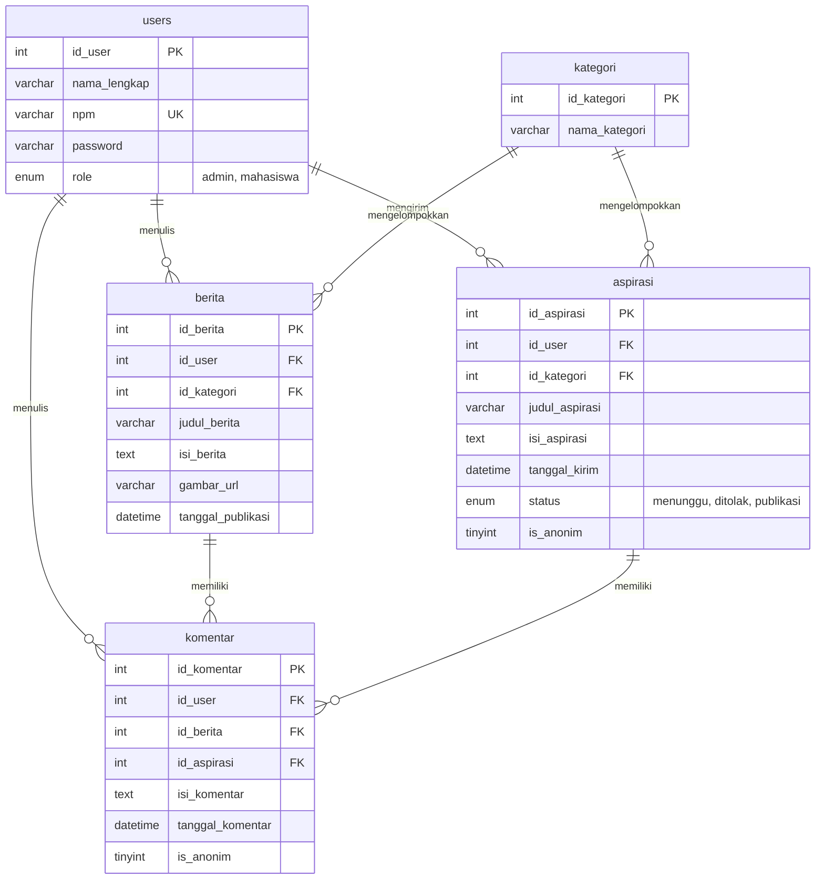

# KabarSi FISIP: Portal Berita & Aspirasi Mahasiswa

Tugas Besar Praktikum Pemrograman Web 2026, Teknik Informatika Universitas Lampung
**Kelompok 17** | Tema: **Fakultas FISIP** (Ilmu Sosial & Ilmu Politik)

KabarSi FISIP adalah portal untuk dua hal: menerbitkan berita kampus, dan menampung aspirasi mahasiswa. Mahasiswa bisa mengirim aspirasi (dengan nama atau anonim), memantau statusnya, dan berdiskusi lewat komentar. Admin menerbitkan berita dan menyeleksi aspirasi sebelum ditampilkan ke publik.

## Anggota Tim

| No | Nama | NPM | Peran |
|---|---|---|---|
| 1 | [Hanzuel Akbar Evansyah] | [2415061060] | Database & Auth Lead |
| 2 | [Joshua Andrew Siahaan]  | [2455061010] | Admin & News Lead |
| 3 | [Defianty Ersa Arfarany] | [2415061080] | User & Aspiration Lead |
| 4 | [Salsabila Aulia Putri]  | [2415061023] | Frontend & Layout Lead |
| 5 | [Thoriq Abdillah]        | [2415061104] | Interactivity & QA Integration Lead (Project Manager) |

## Teknologi

- PHP Native (tanpa framework backend), PDO dengan prepared statement
- MySQL / MariaDB
- HTML, CSS, JavaScript
- Tailwind CSS (via CDN)
- Dijalankan di Laragon atau XAMPP

## Fitur

**Pengunjung (belum login)**
- Melihat beranda, daftar berita, dan aspirasi yang sudah dipublikasikan
- Membaca detail berita, detail aspirasi, dan komentar
- Memfilter berita berdasarkan kategori

**Mahasiswa**
- Registrasi dan login memakai NPM
- Mengirim aspirasi dengan pilihan **Kirim sebagai Anonim**
- Dashboard pribadi: riwayat aspirasi, ringkasan status, filter kategori
- Menulis komentar di berita dan aspirasi, dengan pilihan komentar anonim

**Admin**
- Dashboard statistik (berita, aspirasi, mahasiswa)
- CRUD berita, termasuk unggah gambar (JPG/PNG/WEBP, maks. 2 MB)
- Mengubah status aspirasi
- Komentar admin pada aspirasi ditandai dengan lencana "Admin FISIP"

### Alur Status Aspirasi

| Status | Arti | Tampil di beranda |
|---|---|---|
| `menunggu`     | Aspirasi baru, belum ditinjau admin (nilai awal) | Tidak |
| `ditolak`      | Admin tidak menyetujui aspirasi | Tidak |
| `publikasi`    | Admin menyetujui, aspirasi dipublikasikan | Ya |

Pemilik aspirasi tetap bisa melihat semua aspirasinya sendiri, apa pun statusnya, lewat dashboard.

### Anonimitas

Anonim berlaku untuk aspirasi dan komentar. Jika dicentang, nama pengirim diganti "Anonim" pada semua tampilan. Pengguna tetap wajib login, dan identitas pengirim tetap tersimpan di database untuk keperluan pengelolaan.

## Instalasi

**Kebutuhan:** PHP 8.1.10, MySQL/MariaDB, Laragon atau XAMPP.

1. Salin folder `kelompok_17` ke `www` (Laragon) atau `htdocs` (XAMPP).
2. Jalankan Apache dan MySQL.
3. Buat database dan tabel dengan mengimpor `kabarsi.sql` lewat phpMyAdmin atau HeidiSQL.
   Jika database `kabarsi` sudah ada dari percobaan sebelumnya, hapus dulu (`DROP DATABASE kabarsi;`), baru impor ulang.
4. Periksa `config/database.php`. Bawaannya `host=localhost`, `user=root`, password kosong. Sesuaikan jika berbeda.
5. Pastikan folder `uploads/` ada di dalam `kelompok_17/` dan bisa ditulis (untuk gambar berita).
6. Buka `http://localhost/<path-ke>/kelompok_17/` di browser.

## Akun Uji

| Role | NPM | Password |
|---|---|---|
| Admin | `admin123` | `password` |

Akun mahasiswa baru bisa dibuat lewat halaman **Daftar**.

## Cara Penggunaan

**Mahasiswa**
1. Daftar akun, lalu login.
2. Buka **Dashboard Saya**, klik **Kirim aspirasi**.
3. Isi judul, kategori, dan isi. Centang anonim bila perlu.
4. Pantau status di dashboard. Aspirasi muncul di beranda setelah admin mengubah statusnya menjadi `publikasi`.
5. Komentar bisa ditulis di halaman detail berita atau aspirasi.

**Admin**
1. Login dengan akun admin, otomatis masuk ke panel admin.
2. Menu **Berita**: tambah, edit, hapus berita.
3. Menu **Aspirasi**: ubah status tiap aspirasi, lalu klik **Simpan**.

## Struktur Folder

```text
kelompok_17/
├── admin/          # Panel admin (dashboard, kelola berita, kelola aspirasi)
├── api/            # Endpoint API (aspirasi, berita, kategori, komentar, users)
├── assets/         # Gambar dan aset statis
├── auth/           # Login, register, logout
├── components/     # Komponen tampilan bersama (header, footer, navigasi admin)
├── config/         # Koneksi database (PDO)
├── css/            # css detail berita dan  
├── includes/       # Helper (CSRF, otorisasi admin, unggah gambar)
├── js/             # JavaScript
├── user/           # Dashboard dan form aspirasi mahasiswa
├── uploads/        # Gambar berita yang diunggah admin
├── index.php            # Beranda
├── berita_detail.php    # Detail berita + komentar
├── aspirasi_detail.php  # Detail aspirasi + diskusi
└── kabarsi.sql          # Skema database + data awal
```

## Database

Lima tabel: `users`, `kategori`, `berita`, `aspirasi`, `komentar`. Skema lengkap ada di `kabarsi.sql`.



Pada tabel `komentar`, tepat satu dari `id_berita` atau `id_aspirasi` terisi, satunya `NULL`.

## Keamanan

- Password disimpan dengan `password_hash()` dan diperiksa dengan `password_verify()`
- Seluruh query memakai prepared statement (PDO)
- Output dibersihkan dengan `htmlspecialchars()` untuk mencegah XSS
- `session_regenerate_id()` saat login untuk mencegah session fixation
- Token CSRF pada form admin dan form komentar
- Halaman admin dibatasi role `admin`, halaman mahasiswa dibatasi role `mahasiswa`
- Unggah gambar divalidasi dari isi file (bukan hanya ekstensi), dengan nama acak

## Screenshot

| Halaman | Tampilan |
|---|---|
| Beranda |  |
| Detail berita + komentar |  |
| Detail aspirasi |  |
| Login / Daftar |  |
| Dashboard mahasiswa |  |
| Form kirim aspirasi |  |
| Dashboard admin |  |
| Kelola berita |  |
| Kelola aspirasi |  |

## Catatan Pengerjaan

**31 Oktober**
- Membuat struktur folder dan menentukan serta membuat ERD.
