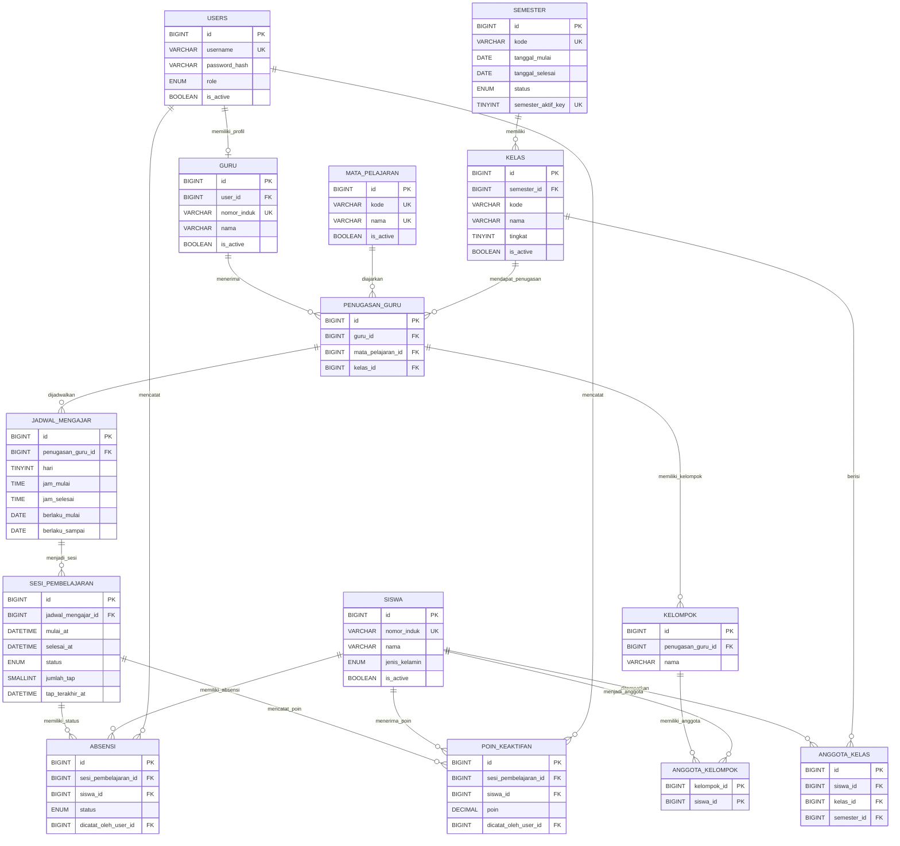

# ATTENDARA

ATTENDARA adalah rancangan aplikasi administrasi pembelajaran untuk SMA. Aplikasi membantu Admin menyiapkan semester, kelas, guru, mata pelajaran, penugasan, dan jadwal; lalu membantu Guru menjalankan sesi kelas, mencatat status kehadiran, memberi poin keaktifan, dan mengatur kelompok.

Siswa tidak memiliki akun. Jenis kelamin siswa wajib diisi karena digunakan sebagai kriteria saat Guru mengacak kelompok yang seimbang.

## Latar belakang

Guru SMA dapat mengajar beberapa mata pelajaran dan beberapa kelas. Karena itu, hubungan guru, mata pelajaran, dan kelas disimpan sebagai penugasan tersendiri. Jadwal mengacu pada penugasan tersebut agar sistem dapat menunjukkan kapan Guru mengajar dan dari jadwal mana sesi dimulai.

Setiap semester memiliki rombongan kelasnya sendiri. Kode kelas yang sama dapat digunakan kembali pada semester berbeda, tetapi datanya tetap terpisah. Dengan begitu, kelas dan penugasan semester berjalan dapat dipilih tanpa mencampur data semester lama, sementara riwayat lama tetap tersimpan.

## Alur aplikasi yang direncanakan

1. **Admin menyiapkan semester berjalan.** Admin membuat atau memilih semester yang sedang berlaku, kemudian membuat rombongan kelas untuk semester tersebut.
2. **Admin mengisi data sekolah.** Admin mengelola profil Guru, data Siswa termasuk jenis kelamin, dan daftar mata pelajaran. Siswa ditempatkan ke kelas pada semester berjalan.
3. **Admin membuat penugasan dan jadwal.** Satu penugasan menghubungkan satu Guru, satu mata pelajaran, dan satu kelas. Seorang Guru dapat memiliki banyak penugasan. Jadwal berisi hari dan jam untuk penugasan; satu penugasan dapat memiliki lebih dari satu jadwal.
4. **Guru melihat jadwalnya dan memulai sesi.** Sesi dimulai dari jadwal, lalu menyimpan waktu mulai dan waktu selesai aktualnya.
5. **Guru menghitung tap secara anonim.** Tap hanya menambah hitungan pada sesi; sistem tidak mencatat siswa yang menekan tombol. Server menerapkan jeda dua detik antar-tap dalam sesi yang sama dan membatasi hitungan agar tidak melebihi jumlah siswa dalam kelas. Guru dapat membetulkan hitungan secara manual.
6. **Guru menetapkan siswa yang tidak hadir.** Saat sesi dimulai, setiap siswa dalam kelas memiliki status awal `hadir`. Karena tap bersifat anonim, Guru mencocokkan selisih hitungan dengan siswa yang tidak hadir setelah bertanya langsung, lalu mengubah status siswa tersebut menjadi `izin`, `sakit`, atau `alpha`. Sesi hanya dapat diselesaikan jika jumlah tap ditambah jumlah status non-hadir sama dengan jumlah siswa dalam daftar sesi.
7. **Guru mengelola kelompok dan poin.** Kelompok terikat pada penugasan Guru dan dapat dikelola di luar sesi. Pengacakan kelompok dapat mempertimbangkan komposisi jenis kelamin. Poin keaktifan dicatat per siswa pada sesi tertentu; satu siswa dapat menerima beberapa penambahan poin pada sesi yang sama.

## Rancangan database

Rancangan entitas dan relasi terbaru ada di [docs/ERD.md](docs/ERD.md). Entitas utamanya adalah:

- `users`, `guru`, dan `siswa` untuk akun dan profil; hanya Admin dan Guru yang masuk ke aplikasi.
- `mata_pelajaran` untuk data mata pelajaran.
- `semester`, `kelas`, dan `anggota_kelas` untuk rombongan kelas dan daftar siswa per semester.
- `penugasan_guru` dan `jadwal_mengajar` untuk menghubungkan Guru, mata pelajaran, kelas, serta waktu rencana mengajar.
- `sesi_pembelajaran` dan `absensi` untuk sesi aktual, hitungan tap anonim, dan status akhir siswa.
- `kelompok`, `anggota_kelompok`, dan `poin_keaktifan` untuk pengelolaan pembelajaran.

### ERD (notasi Barker / Crow's Foot)

Diagram berikut menggunakan kardinalitas Barker: `||` berarti tepat satu, `o|` berarti nol atau satu, `|{` berarti satu atau lebih, dan `o{` berarti nol atau lebih. Tanda di ujung garis menunjukkan jumlah entitas pada sisi tersebut untuk satu entitas di sisi seberang. Contohnya, satu `penugasan_guru` memiliki nol atau banyak jadwal, sedangkan setiap jadwal harus mengacu pada tepat satu penugasan.

Constraint unik gabungan pada SQL juga berlaku walaupun tidak ditampilkan sebagai atribut tunggal pada diagram: `(semester_id, kode)` pada `kelas`, `(siswa_id, semester_id)` pada `anggota_kelas`, `(guru_id, mata_pelajaran_id, kelas_id)` pada `penugasan_guru`, serta pasangan sesi/siswa pada `absensi` dan kelompok/siswa pada `anggota_kelompok`. `semester_aktif_key` adalah kolom terhitung untuk memastikan hanya satu semester berstatus aktif.

**Status implementasi:** `database/attendara.sql` dan `database/attendara_dummy.sql` sekarang mengikuti ERD revisi. Kode PHP Admin/Guru masih memakai model lama: antara lain belum memakai penugasan mata pelajaran, kelas per semester, hitungan tap anonim di database, dan tabel poin baru. Karena itu, halaman aplikasi belum kompatibel dengan skema target sampai kode PHP dimigrasikan.

## Teknologi dan menyiapkan database target

Proyek memakai PHP Native, PDO, dan MySQL/MariaDB. Untuk pengembangan lokal dapat menggunakan Laragon atau server PHP lokal.

1. Siapkan PHP dengan ekstensi `pdo_mysql` dan server MySQL/MariaDB.
2. Atur konfigurasi koneksi database lewat environment proses PHP/web server:
   - `ATTENDARA_DB_HOST` (opsional, default `127.0.0.1`)
   - `ATTENDARA_DB_NAME` (opsional, default `attendara`)
   - `ATTENDARA_DB_USER` (default `root` hanya untuk host lokal; wajib untuk host lain)
   - `ATTENDARA_DB_PASSWORD` (opsional; isi kosong jika database lokal tidak memakai password)
3. Impor `database/attendara.sql` ke database `attendara` yang **baru/kosong** untuk membuat skema target. File koneksi [config/database.php](config/database.php) hanya membuka koneksi; file itu tidak membuat atau memigrasikan tabel.
4. Untuk data demo yang bermakna, impor `database/attendara_dummy.sql` sekali saja setelah skema dibuat dan masih kosong. Akun demo tetap `admin` dengan password `admin`, serta `guru1` sampai `guru5` dengan password yang sama seperti username. Data profil guru, siswa, kelas, dan mata pelajaran memakai nama contoh.
5. Impor file SQL saja belum membuat halaman PHP kompatibel. Migrasikan kode Admin/Guru sebelum menjalankan alur aplikasi lengkap. Setelah migrasi, buka `login.php` melalui web server PHP, misalnya Laragon.

Kedua file SQL memakai `CREATE TABLE IF NOT EXISTS`; mengimpornya ke database lama **tidak mengubah tabel lama**. Buat database baru/kosong untuk skema revisi, atau siapkan dan jalankan migrasi terencana setelah mencadangkan database lama.

> **Catatan keamanan:** jangan menyimpan kredensial database produksi di repository. Gunakan environment web server dan ganti/hapus akun demo sebelum aplikasi dipublikasikan.

## Login dan autentikasi versi saat ini

Login saat ini membaca `users.username`, `users.password_hash`, `users.is_active`, dan `users.role`. Pengguna aktif diarahkan ke dashboard sesuai role. Halaman Admin dan Guru mewajibkan autentikasi role; formulir perubahan data memakai token CSRF. Session berakhir setelah 30 menit tidak aktif atau 8 jam sejak autentikasi.

Helper autentikasi berada di `config/auth.php`. Halaman di dalam `admin/` atau `guru/` memuat helper tersebut dan memanggil `startAppSession()` sebelum membaca session. Fungsi yang tersedia meliputi `currentUser()`, `isLoggedIn()`, `requireLogin()`, `requireRole()`, `redirectToDashboard()`, `appUrl()`, `csrfToken()`, `verifyCsrfToken()`, dan `h()`.

Logout dilakukan melalui POST ke `logout.php` dengan field `_csrf_token`; endpoint memverifikasi token, mengakhiri session, lalu mengarahkan pengguna ke halaman login.

## Batas dan pekerjaan berikutnya

Skema SQL dan data demo sudah memakai model semester, penugasan mata pelajaran, jadwal, tap anonim, kelompok, dan poin pada ERD. Pekerjaan berikutnya adalah menyesuaikan kode PHP agar membaca dan menulis struktur baru tersebut.