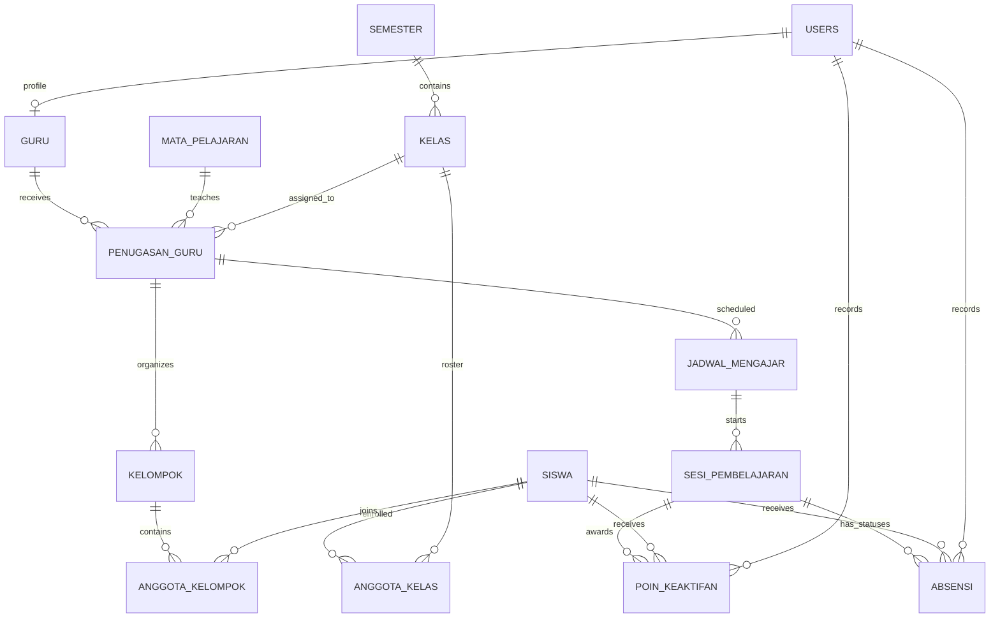

# ATTENDARA — Rancangan ERD Revisi

## Tujuan dan status

Dokumen ini menjelaskan rancangan database ATTENDARA berdasarkan alur yang telah disepakati. `database/attendara.sql` sekarang membuat skema sesuai rancangan ini; kode PHP yang ada masih perlu disesuaikan sebelum dapat memakai skema baru.

ATTENDARA adalah aplikasi administrasi pembelajaran SMA dengan dua role: Admin dan Guru. Siswa tidak memiliki akun. Admin mengelola semester, kelas, siswa, mata pelajaran, penugasan guru, dan jadwal. Guru melihat jadwal penugasannya, memulai sesi, menghitung tap kehadiran secara anonim, menetapkan status siswa yang tidak hadir, mencatat poin keaktifan, dan mengelola kelompok.

Riwayat kelas, semester, penugasan, sesi, absensi, kelompok, dan poin tetap disimpan. Data kelas untuk semester lama tidak muncul sebagai pilihan kelas aktif pada penugasan/jadwal semester berjalan.

## Rancangan entitas

Semua tabel memakai PK `id BIGINT UNSIGNED` kecuali tabel penghubung yang menggunakan PK gabungan. Tipe berikut adalah rancangan konseptual; constraint dan tipe akhir harus dicocokkan dengan implementasi MySQL.

### `users` — akun Admin dan Guru

- `id` — PK.
- `username` — unik dan wajib.
- `password_hash` — wajib.
- `role` — `admin` atau `guru`.
- `is_active` — status akun.
- `created_at`, `updated_at`.

Siswa tidak memiliki akun.

### `guru` — profil guru

- `id` — PK.
- `user_id` — FK ke `users.id`, unik dan wajib.
- `nomor_induk`, `nama` — wajib.
- `email`, `no_telepon` — opsional.
- `is_active`, `created_at`, `updated_at`.

### `siswa` — data master siswa

- `id` — PK.
- `nomor_induk` — unik dan wajib.
- `nama` — wajib.
- `jenis_kelamin ENUM('L','P')` — wajib untuk pengacakan kelompok seimbang.
- `tanggal_lahir` — opsional.
- `is_active`, `created_at`, `updated_at`.

### `mata_pelajaran` — daftar mata pelajaran

- `id` — PK.
- `kode` — unik dan wajib.
- `nama` — wajib.
- `is_active`, `created_at`, `updated_at`.

### `semester` — periode akademik

- `id` — PK.
- `kode` — unik dan wajib.
- `nama`, `tanggal_mulai`, `tanggal_selesai` — wajib.
- `status` — `direncanakan`, `aktif`, atau `selesai`; hanya satu semester dapat berstatus `aktif`.
- `created_at`, `updated_at`.

Admin menetapkan semester berjalan. Form penugasan dan jadwal hanya menawarkan kelas dari semester berjalan. Riwayat semester lampau tetap tersedia untuk arsip.

### `kelas` — rombongan belajar pada satu semester

- `id` — PK.
- `semester_id` — FK ke `semester.id`, wajib.
- `kode`, `nama`, `tingkat` — wajib sesuai format sekolah.
- `is_active`, `created_at`, `updated_at`.

Satu baris kelas mewakili rombongan belajar dalam satu semester. Kode seperti `X-A` boleh dipakai lagi pada semester berbeda; pasangan `(semester_id, kode)` yang unik. Dengan demikian kelas semester lama dan kelas semester baru adalah konteks berbeda.

### `anggota_kelas` — siswa yang terdaftar di kelas semester tersebut

- `id` — PK.
- `siswa_id` — FK ke `siswa.id`, wajib.
- `kelas_id` — FK ke `kelas.id`, wajib.
- `semester_id` — FK ke `semester.id`, wajib dan harus sama dengan semester kelas.
- `created_at`.

Siswa dan kelas berelasi banyak-ke-banyak sepanjang riwayat. Kunci gabungan kelas/semester memastikan semester penempatan sama dengan semester kelas. Kombinasi `(siswa_id, semester_id)` unik memastikan satu siswa hanya memiliki satu kelas per semester. Jika mutasi kelas tengah semester perlu didukung, aturan waktunya perlu ditambahkan.

### `penugasan_guru` — guru, mata pelajaran, dan kelas

- `id` — PK.
- `guru_id` — FK ke `guru.id`, wajib.
- `mata_pelajaran_id` — FK ke `mata_pelajaran.id`, wajib.
- `kelas_id` — FK ke `kelas.id`, wajib; semester didapat dari kelas.
- `created_at`.

Satu guru dapat memiliki banyak baris penugasan untuk berbagai mata pelajaran dan kelas. Mata pelajaran dan kelas juga dapat muncul pada banyak penugasan. Setiap baris menyatakan satu pasangan guru–mata pelajaran–kelas. Kombinasi yang sama untuk guru yang sama tidak boleh terduplikasi; guru berbeda tetap dapat ditugaskan pada mata pelajaran dan kelas yang sama.

### `jadwal_mengajar` — waktu rencana suatu penugasan

- `id` — PK.
- `penugasan_guru_id` — FK ke `penugasan_guru.id`, wajib.
- `hari` — hari dalam minggu.
- `jam_mulai`, `jam_selesai` — waktu rencana, wajib.
- `berlaku_mulai`, `berlaku_sampai` — tanggal masa berlaku; opsional jika jadwal berlaku selama penugasan.
- `created_at`, `updated_at`.

Jadwal tidak digenerate dari penugasan: penugasan tidak memuat hari dan jam. Admin memasukkan satu atau lebih jadwal untuk penugasan. Jadwal selalu menunjuk penugasan sehingga guru, mata pelajaran, kelas, dan semester dapat diketahui dari relasinya.

### `sesi_pembelajaran` — kejadian kelas yang benar-benar berlangsung

- `id` — PK.
- `jadwal_mengajar_id` — FK ke `jadwal_mengajar.id`, wajib.
- `mulai_at DATETIME` — waktu aktual mulai.
- `selesai_at DATETIME` — waktu aktual selesai; kosong selama sesi berjalan.
- `status` — `berlangsung`, `selesai`, atau `dibatalkan`.
- `jumlah_tap SMALLINT UNSIGNED` — jumlah tap anonim yang diterima pada sesi; mulai dari nol dan dapat dikoreksi manual.
- `tap_terakhir_at` — waktu tap terakhir yang diterima, untuk menerapkan jeda dua detik antar-tap pada sesi yang sama.
- `created_at`, `updated_at`.

Sesi dimulai dari jadwal. Waktu rencana tetap berada di `jadwal_mengajar`; waktu aktual dicatat di sesi. Tap tidak mengidentifikasi siswa dan tidak membuat baris per tap. Server menolak tap berikutnya bila jeda dua detik belum berlalu dan membatasi jumlah tap agar tidak melampaui jumlah siswa dalam daftar sesi. Koreksi manual dapat menaikkan atau menurunkan `jumlah_tap` dalam rentang nol sampai jumlah siswa.

### `absensi` — status akhir tiap siswa dalam sesi

- `id` — PK.
- `sesi_pembelajaran_id` — FK ke `sesi_pembelajaran.id`, wajib.
- `siswa_id` — FK ke `siswa.id`, wajib.
- `status` — `hadir`, `izin`, `sakit`, atau `alpha`; default `hadir` ketika sesi dibuat.
- `dicatat_oleh_user_id` — FK ke `users.id`, Guru yang membuat/terakhir mengubah catatan.
- `waktu_dicatat DATETIME`, `catatan VARCHAR(500)` — waktu pencatatan dan catatan opsional.

Saat sesi dimulai, sistem membuat satu baris untuk setiap siswa dalam kelas dan mengisi status awal `hadir`. Tap hanya mengubah `jumlah_tap` pada sesi, bukan status siswa tertentu. Guru mencari tahu siswa yang tidak hadir dan mengganti status siswa tersebut pada daftar. Satu pasangan `(sesi_pembelajaran_id, siswa_id)` hanya memiliki satu status akhir.

Sesi hanya dapat diselesaikan jika jumlah tap ditambah jumlah siswa dengan status bukan `hadir` sama dengan jumlah siswa dalam daftar sesi. Contoh: 34 tap dan dua siswa diubah menjadi `izin`/`sakit`/`alpha` untuk kelas berisi 36 siswa. Pemeriksaan ini dilakukan aplikasi secara transaksional sebelum sesi ditandai selesai.

### `kelompok` — kelompok belajar dalam penugasan

- `id` — PK.
- `penugasan_guru_id` — FK ke `penugasan_guru.id`, wajib.
- `nama` — wajib.
- `created_at`, `updated_at`.

Kelompok terikat ke penugasan, sehingga guru dapat memiliki kelompok berbeda untuk mata pelajaran berbeda pada kelas yang sama. Kelompok dapat dilihat dan dikelola di luar sesi belajar. Pengacakan dapat membagi anggota dengan mempertimbangkan `jenis_kelamin`; cara menyeimbangkan jumlah laki-laki/perempuan dilakukan oleh aplikasi.

### `anggota_kelompok` — anggota setiap kelompok

- `kelompok_id` — FK ke `kelompok.id`, bagian PK gabungan.
- `siswa_id` — FK ke `siswa.id`, bagian PK gabungan.
- `created_at`.

Aplikasi harus memastikan anggota kelompok berasal dari kelas pada penugasan yang menaungi kelompok tersebut.

### `poin_keaktifan` — penambahan poin siswa pada sesi

- `id` — PK.
- `sesi_pembelajaran_id` — FK ke `sesi_pembelajaran.id`, wajib.
- `siswa_id` — FK ke `siswa.id`, wajib.
- `poin DECIMAL(7,2)` — jumlah poin positif yang ditambahkan.
- `dicatat_oleh_user_id` — FK ke `users.id`, Guru pencatat.
- `waktu_dicatat`, `catatan` — waktu dan catatan opsional.

Setiap penambahan poin adalah baris tersendiri. Satu siswa dapat memiliki beberapa catatan poin dalam satu sesi; total poin sesi dihitung dari baris-baris tersebut. Poin melekat pada sesi tertentu dan hanya dapat dicatat Guru yang memiliki penugasan sesi.

## Relasi utama

- `users` 1 : 0..1 `guru`; akun Admin tidak memiliki profil guru.
- `semester` 1 : N `kelas`.
- `siswa` M : N `kelas` melalui `anggota_kelas`.
- `guru` M : N `mata_pelajaran` dan `kelas` melalui `penugasan_guru`; satu penugasan memiliki satu guru, satu mata pelajaran, dan satu kelas.
- `penugasan_guru` 1 : N `jadwal_mengajar`.
- `jadwal_mengajar` 1 : N `sesi_pembelajaran`.
- `sesi_pembelajaran` 1 : N `absensi`; setiap baris absensi menunjuk satu siswa.
- `sesi_pembelajaran` 1 : N `poin_keaktifan`; setiap catatan poin menunjuk satu siswa.
- `penugasan_guru` 1 : N `kelompok`.
- `kelompok` M : N `siswa` melalui `anggota_kelompok`.

## Constraint dan integritas yang direncanakan

- Unik: `users.username`, `guru.user_id`, `guru.nomor_induk`, `siswa.nomor_induk`, `mata_pelajaran.kode`, `mata_pelajaran.nama`, `semester.kode`, dan `(kelas.semester_id, kelas.kode)`.
- Hanya satu semester berstatus `aktif`, ditegakkan dengan kunci unik pada kolom terhitung.
- Satu kelas per siswa per semester: `anggota_kelas(siswa_id, semester_id)` unik; FK komposit memastikan semester penempatan sama dengan semester kelas.
- Satu baris penugasan untuk kombinasi `(guru_id, mata_pelajaran_id, kelas_id)`; guru berbeda tetap boleh mengajar mata pelajaran/kelas yang sama.
- `absensi(sesi_pembelajaran_id, siswa_id)` unik.
- `anggota_kelompok(kelompok_id, siswa_id)` unik melalui PK gabungan.
- `poin_keaktifan` tidak unik per sesi dan siswa karena satu siswa dapat menerima beberapa penambahan poin dalam sesi yang sama.
- Semua FK memakai kebijakan penghapusan yang menjaga data riwayat; data historis sebaiknya diarsipkan/nonaktifkan, bukan dihapus berantai.
- Server harus mengotorisasi perubahan absensi, poin, kelompok, serta sesi berdasarkan Guru pemilik penugasan. FK saja tidak cukup untuk pemeriksaan hak akses.
- Tap anonim harus diubah secara atomik di sisi server: memeriksa jeda dua detik, memeriksa batas jumlah siswa, dan memperbarui `jumlah_tap` serta `tap_terakhir_at` dalam satu transaksi.
- Koreksi jumlah tap harus menjaga rentang `0..jumlah_siswa_sesi`. Sesi tidak boleh selesai sebelum persamaan jumlah tap dan status non-hadir terpenuhi.
- Keanggotaan kelas/kelompok dan siswa pada sesi harus divalidasi agar hanya siswa roster kelas terkait yang dicatat.

## Hal yang masih perlu ditetapkan

1. Apakah kelas memakai kode tingkat/rombel tertentu dan apakah mutasi siswa tengah semester perlu didukung.
2. Status final semester dan aturan penetapan semester berjalan tunggal.
3. Apakah masa berlaku jadwal perlu tanggal akhir atau cukup mengikuti semester.
4. Apakah koreksi jumlah tap perlu menyimpan alasan dan riwayat koreksi, atau nilai terkoreksi pada sesi sudah cukup.
5. Apakah status sesi `dibatalkan` memerlukan alasan.
6. Apakah poin keaktifan perlu pecahan; skema saat ini menerima nilai positif dengan dua angka desimal.
7. Apakah akun wajib bagi setiap Guru dan kolom profil tambahan yang diperlukan.

## Batas dokumen

Dokumen ini adalah rancangan ERD. Skema SQL dan data demo sudah disusun mengikuti rancangan ini, tetapi backend serta halaman Admin/Guru masih perlu dimigrasikan sebelum aplikasi dapat berjalan dengan skema baru.
