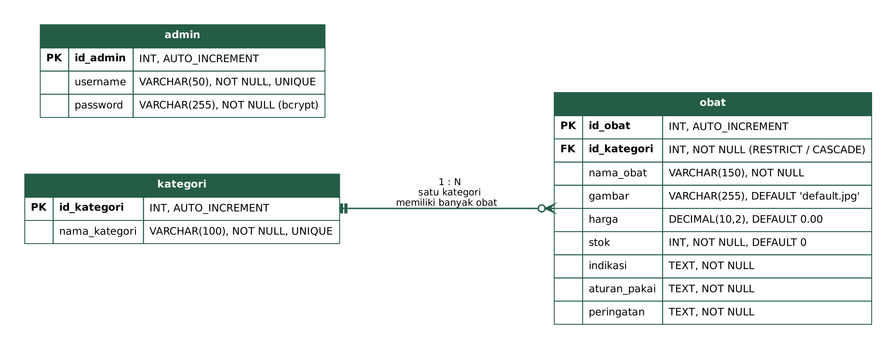
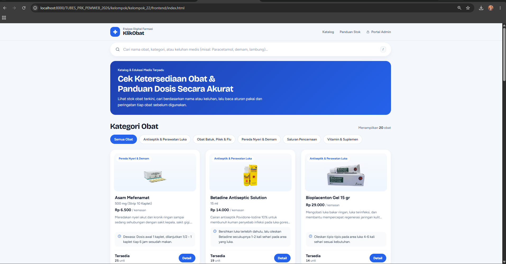
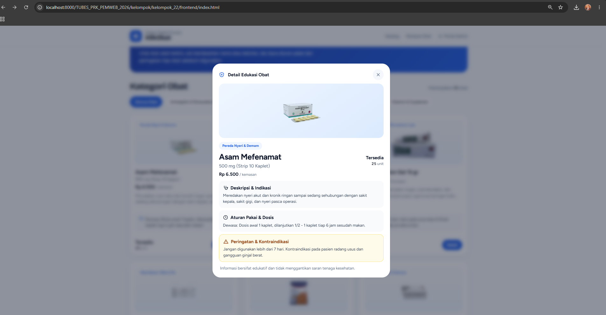
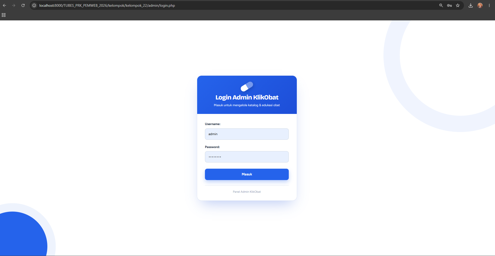
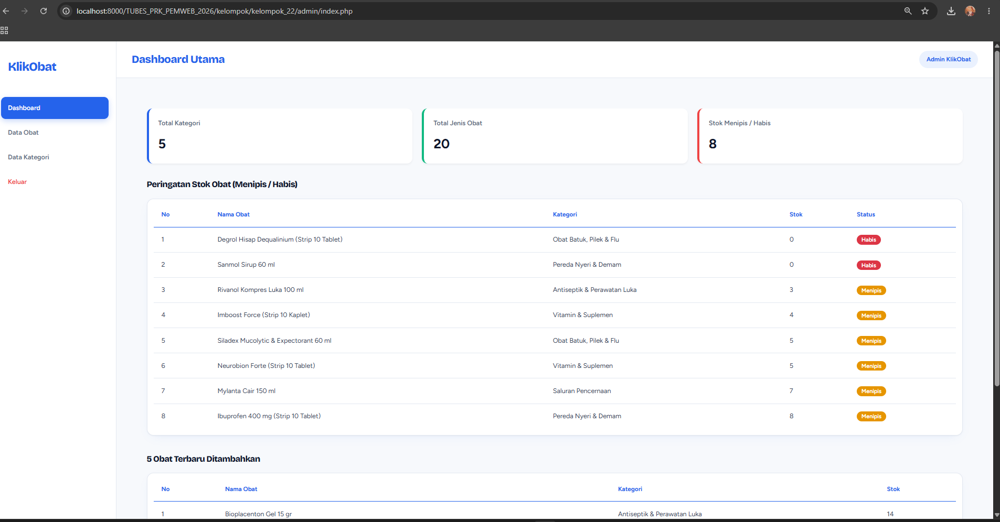
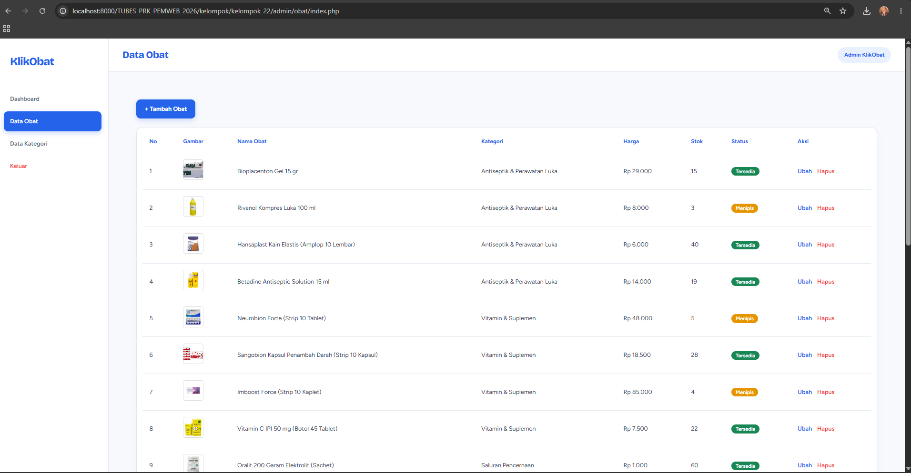
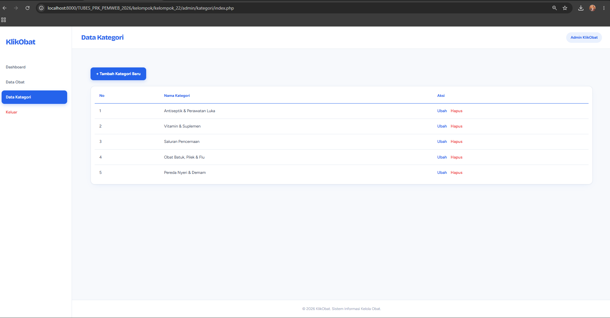

# 💊 KlikObat — Sistem Informasi Katalog Farmasi & Edukasi Kesehatan

**Kelompok 22 | Tema 06: Fakultas Kedokteran**
Praktikum Pemrograman Web 2026 — Teknik Informatika, Universitas Lampung

**Repository:** https://github.com/RiffaYP/TUBES_PRK_PEMWEB_2026 (branch `staging`)

---

## 1. Deskripsi Singkat Sistem

**KlikObat** adalah platform web informatif yang bertindak sebagai etalase digital untuk apotek atau klinik. Sistem ini menampilkan katalog ketersediaan obat secara *real-time* menggunakan **Fetch API** (tanpa *reload* halaman) serta menyediakan edukasi kesehatan mengenai indikasi, aturan pakai, dan peringatan (kontraindikasi).

### Fitur utama

**Halaman publik (katalog)**
- Katalog obat dengan foto, harga, dan status stok (Tersedia / Menipis / Habis)
- Pencarian obat (nama, indikasi, kategori) dan filter per kategori tanpa reload
- Modal edukasi: indikasi, aturan pakai, dan peringatan setiap obat
- Data lokal cadangan (*fallback*) bila API tidak dapat dijangkau

**Halaman admin** (perlu login)
- Autentikasi admin dengan sesi PHP dan password ter-hash (bcrypt)
- Dashboard: statistik, peringatan stok menipis/habis, dan 5 obat terbaru
- CRUD Kategori (kategori yang masih dipakai obat tidak dapat dihapus)
- CRUD Obat, termasuk upload gambar (JPG/PNG, maks. 2 MB)

---

## 2. Identitas Kelompok 22

| No | NPM | Nama Lengkap | Peran / Modul |
| :---: | :---: | :--- | :--- |
| 1 | 2415061091 | Riffa Yudika Permana | Backend API Publik |
| 2 | 2415061041 | Irma Hayyu Sani | Autentikasi Admin & CRUD Kategori |
| 3 | 2415061081 | Ledi Daiyana Alfara | CRUD Obat (Admin) |
| 4 | 2415061090 | Rifki Yudika Perdana | Frontend Katalog (SPA Fetch API) |
| 5 | 2415061117 | Farel Raditya Surya Negara | Database & Konfigurasi Inti |
| 6 | 2455061009 | Rachel Inaya Allantama | Modal Edukasi, UI Admin Bersama & QA |

---

## 3. Teknologi yang Digunakan

- **Frontend:** HTML5, CSS3, Vanilla JavaScript (Fetch API)
- **Backend:** PHP Native (MySQLi) — penyedia JSON API dan manajemen admin. Disarankan PHP 7.4 atau lebih baru dengan ekstensi `mysqli` (mysqlnd)
- **Database:** MySQL / MariaDB (`klikobat`)
- **Server lokal:** Laragon atau XAMPP (Apache + MySQL)

---

## 4. Struktur Folder

```text
kelompok_22/
├── frontend/            # Halaman katalog publik (index.html, CSS, JS)
├── api/                 # Endpoint JSON publik (kategori, obat, obat_detail)
├── admin/               # Login, dashboard, CRUD kategori, CRUD obat
├── backend/             # Koneksi DB, helper, dan layout admin (header/sidebar/footer)
├── config/              # Pintasan ke backend/koneksi.php dan backend/helper.php
├── assets/images/obat/  # Foto produk obat
├── database/            # klikobat.sql (skema + data awal)
└── docs/                # Dokumentasi teknis, ERD, dan screenshot
```

---

## 5. Panduan Instalasi dan Menjalankan Aplikasi

1. **Siapkan server.** Jalankan **Apache** dan **MySQL** pada Laragon / XAMPP.
2. **Letakkan proyek** di folder web server (`www` pada Laragon atau `htdocs` pada XAMPP) dengan struktur berikut:

   ```text
   <folder-web-server>/TUBES_PRK_PEMWEB_2026/kelompok/kelompok_22/
   ```

   Cara termudah: *clone* repository ke folder web server.

   ```bash
   git clone -b staging https://github.com/RiffaYP/TUBES_PRK_PEMWEB_2026.git
   ```

   > **Penting:** tautan pada sidebar dan logo halaman admin memakai path absolut
   > `/TUBES_PRK_PEMWEB_2026/kelompok/kelompok_22/...`. Jika folder diberi nama atau diletakkan di lokasi lain, ubah path tersebut di `backend/admin/layout/sidebar.php`.

3. **Impor database.** Buka phpMyAdmin (`http://localhost/phpmyadmin`), pilih tab **Import**, lalu impor `database/klikobat.sql`. Atau lewat terminal:

   ```bash
   mysql -u root -p < database/klikobat.sql
   ```

   Database `klikobat` otomatis dibuat beserta **5 kategori**, **20 data obat**, dan **1 akun admin**. (Mengimpor ulang akan mengatur ulang seluruh data.)
4. **Cek konfigurasi koneksi** pada `backend/koneksi.php` (dimuat juga oleh `config/koneksi.php`). Nilai bawaan:

   | host | user | password | database | port |
   |---|---|---|---|---|
   | `localhost` | `root` | *(kosong)* | `klikobat` | `3306` |

   Sesuaikan jika pengaturan MySQL lokal Anda berbeda.
5. **Buka aplikasi** di browser:

   | Halaman | URL |
   |---|---|
   | Katalog publik | `http://localhost/TUBES_PRK_PEMWEB_2026/kelompok/kelompok_22/frontend/index.html` |
   | Login admin | `http://localhost/TUBES_PRK_PEMWEB_2026/kelompok/kelompok_22/admin/login.php` |
   | Contoh API | `http://localhost/TUBES_PRK_PEMWEB_2026/kelompok/kelompok_22/api/obat.php` |

### Akun default admin

| Username | Password |
|---|---|
| `admin` | `password` |

> Ganti password default sebelum aplikasi dipakai di luar keperluan tugas.

### Catatan penggunaan

- Halaman katalog harus dibuka lewat **server PHP** (Apache), bukan Live Server atau file statis. Jika API tidak dapat dijangkau, katalog beralih ke data lokal cadangan dan menampilkan pemberitahuan (harga tidak ditampilkan pada mode ini).
- Folder `assets/images/obat/` harus dapat ditulis oleh server agar upload gambar obat berfungsi.

---

## 6. Ringkasan API Publik

Semua endpoint bermetode `GET` dan mengembalikan JSON `{ status, message, data }`. Dokumentasi lengkap ada di [`docs/api.md`](docs/api.md).

| Endpoint | Parameter | Fungsi |
|---|---|---|
| `/api/kategori.php` | — | Daftar kategori |
| `/api/obat.php` | `id_kategori`, `q` (opsional) | Daftar obat, dapat difilter dan dicari |
| `/api/obat_detail.php` | `id` (wajib) | Detail satu obat |

---

## 7. Database dan ERD

Database terdiri dari tiga tabel: `kategori`, `obat` (relasi 1:N ke `kategori`), dan `admin`. Berkas skema: [`database/klikobat.sql`](database/klikobat.sql). Penjelasan lengkap: [`docs/database.md`](docs/database.md).



---

## 8. Screenshot Tampilan Aplikasi

| Halaman | Berkas |
|---|---|
| Katalog publik |  |
| Modal edukasi obat |  |
| Login admin |  |
| Dashboard admin |  |
| Data obat (admin) |  |
| Data kategori (admin) |  |

---

## 9. Dokumentasi Tambahan

| Dokumen | Isi |
|---|---|
| [`docs/api.md`](docs/api.md) | Endpoint API publik |
| [`docs/database.md`](docs/database.md) | Skema database dan ERD |
| [`docs/frontend.md`](docs/frontend.md) | Perilaku halaman katalog |
| [`docs/CRUD_obat.md`](docs/CRUD_obat.md) | CRUD obat dan upload gambar |
| [`docs/autentikasi_kategori.md`](docs/autentikasi_kategori.md) | Autentikasi admin dan CRUD kategori |
| [`docs/rancangan_ui.md`](docs/rancangan_ui.md) | Rancangan UI |
| [`docs/log_pengujian.md`](docs/log_pengujian.md) | Log pengujian dan QA |
| [`docs/logbook.md`](docs/logbook.md) | Logbook pengerjaan |
