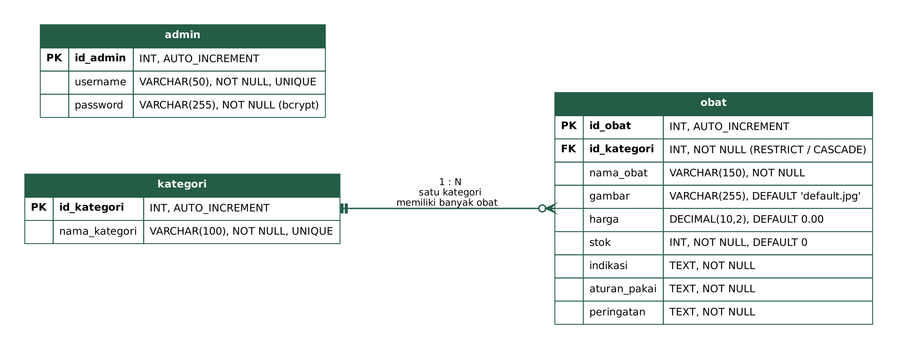
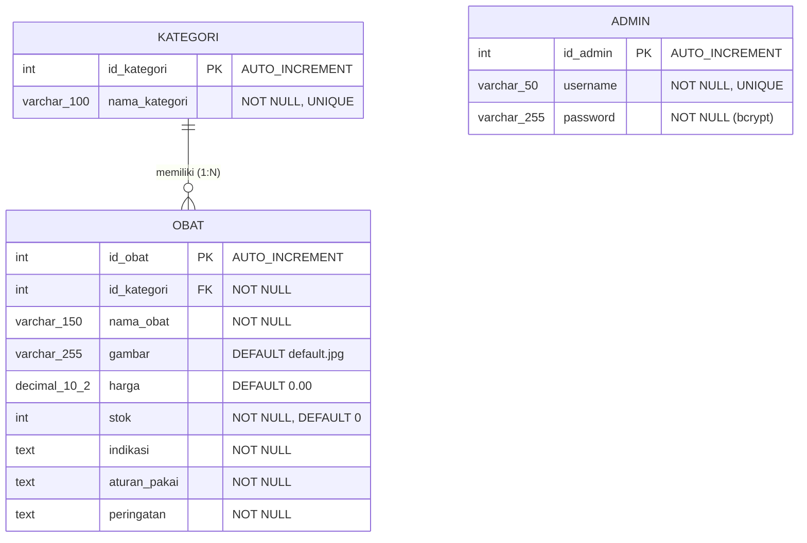

# Dokumentasi Skema Database KlikObat (Kelompok 22)

- **Nama database:** `klikobat`
- **Mesin / charset:** InnoDB, `utf8mb4` (`utf8mb4_unicode_ci`)
- **Berkas SQL:** [`../database/klikobat.sql`](../database/klikobat.sql) (membuat database, 3 tabel, dan data awal)

## 1. Entity Relationship Diagram (ERD)



Versi teks (dirender otomatis oleh GitHub):



Relasi: **satu kategori memiliki banyak obat (1:N)**. Tabel `admin` berdiri sendiri karena hanya dipakai untuk autentikasi.

## 2. Kamus Data

### Tabel `kategori`

| Kolom | Tipe | Constraint | Keterangan |
|---|---|---|---|
| `id_kategori` | INT(11) | PK, AUTO_INCREMENT | ID kategori |
| `nama_kategori` | VARCHAR(100) | NOT NULL, UNIQUE | Nama kategori obat |

### Tabel `obat`

| Kolom | Tipe | Constraint | Keterangan |
|---|---|---|---|
| `id_obat` | INT(11) | PK, AUTO_INCREMENT | ID obat |
| `nama_obat` | VARCHAR(150) | NOT NULL, indeks `idx_nama_obat` | Nama dan sediaan obat |
| `id_kategori` | INT(11) | NOT NULL, FK, indeks `idx_id_kategori` | Mengacu ke `kategori.id_kategori` |
| `gambar` | VARCHAR(255) | NOT NULL, DEFAULT `'default.jpg'` | Nama file di `assets/images/obat/` |
| `harga` | DECIMAL(10,2) | NOT NULL, DEFAULT `0.00` | Harga per kemasan (Rupiah) |
| `stok` | INT(11) | NOT NULL, DEFAULT `0` | Jumlah stok |
| `indikasi` | TEXT | NOT NULL | Kegunaan obat |
| `aturan_pakai` | TEXT | NOT NULL | Dosis dan cara pakai |
| `peringatan` | TEXT | NOT NULL | Peringatan dan kontraindikasi |

Foreign key `fk_obat_kategori`: `ON UPDATE CASCADE`, `ON DELETE RESTRICT`. Artinya kategori yang masih dipakai oleh obat **tidak dapat dihapus** (dicegah juga di level aplikasi pada `admin/kategori/hapus.php`).

### Tabel `admin`

| Kolom | Tipe | Constraint | Keterangan |
|---|---|---|---|
| `id_admin` | INT(11) | PK, AUTO_INCREMENT | ID admin |
| `username` | VARCHAR(50) | NOT NULL, UNIQUE | Nama pengguna |
| `password` | VARCHAR(255) | NOT NULL | Hash **bcrypt** (diverifikasi dengan `password_verify()`) |

## 3. Data Awal (Seed)

| Tabel | Jumlah | Isi |
|---|---|---|
| `kategori` | 5 | Pereda Nyeri & Demam; Obat Batuk, Pilek & Flu; Saluran Pencernaan; Vitamin & Suplemen; Antiseptik & Perawatan Luka |
| `obat` | 20 | 20 obat lengkap dengan harga, gambar, indikasi, aturan pakai, dan peringatan. Stok sengaja bervariasi (ada yang 0, 1-10, dan lebih dari 10) untuk menguji status stok |
| `admin` | 1 | `admin` / `password` (disimpan sebagai hash bcrypt) |

> Ganti password akun default sebelum aplikasi dipakai di luar keperluan tugas.

## 4. Cara Impor

**phpMyAdmin:** buka `http://localhost/phpmyadmin`, pilih tab **Import**, pilih `database/klikobat.sql`, lalu klik **Go**.

**Terminal:**

```bash
mysql -u root -p < database/klikobat.sql
```

Skrip ini memakai `CREATE DATABASE IF NOT EXISTS` dan `DROP TABLE IF EXISTS`, sehingga **mengimpor ulang akan menghapus dan membuat ulang seluruh data** pada tabel `obat`, `kategori`, dan `admin`.
