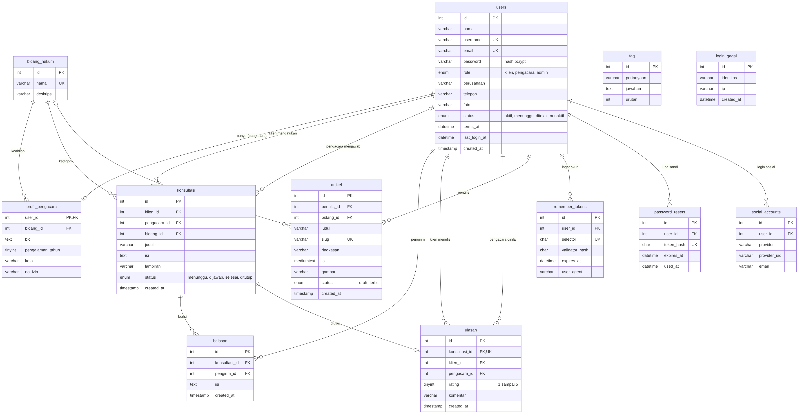
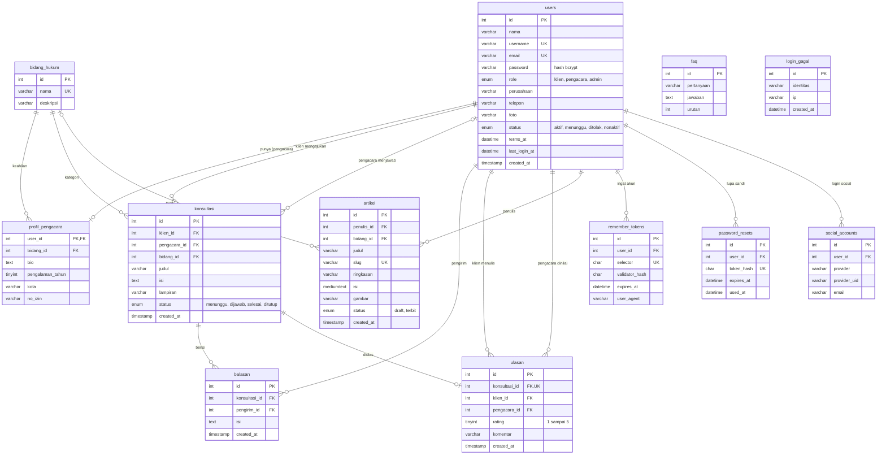

# Ruang Hukum — Konsultasi Hukum Online

**Tugas Besar Praktikum Pemrograman Web 2026 — Kelompok 25**
Teknik Informatika, Universitas Lampung

Ruang Hukum merupakan platform konsultasi hukum online yang mempertemukan klien dengan pengacara terverifikasi. Klien menulis pertanyaan, memilih kategori (bidang hukum), lalu pengacara di bidang itu menjawab secara **privat satu lawan satu**. Setiap konsultasi punya status yang jelas (menunggu, dijawab, selesai, ditutup), dan setiap pengacara punya profil publik berisi bidang keahlian, kota, lama pengalaman, serta rating dari klien. Admin mengelola pengguna, verifikasi pengacara, kategori hukum, konsultasi, artikel, dan FAQ.

Aplikasi dibangun dengan **PHP Native (8.2+, tanpa framework)**, **MySQL/MariaDB (PDO)**, **HTML**, **CSS**, **Bootstrap 5**, dan **JavaScript** ringan (validasi formulir, notifikasi, jendela konfirmasi, pengecekan username langsung).

**Pembeda dari proyek bertema hukum lain:** fokus pada konsultasi privat 1 lawan 1 antara klien dan pengacara, lengkap dengan status konsultasi, kategori hukum, dan profil pengacara. Bukan forum diskusi dan bukan sistem pengaduan.

---

## 👥 Tim Pengembang (Kelompok 25)

| No | Nama Anggota | NPM | Kelas | Peran Utama |
|----|--------------|-----|-------|-------------|
| 1 | **Rafi Zakwan Ekaputra** | 2455061008 | B | **Ketua Tim**: Arsitektur & Fondasi, Desain Sistem, Database, Autentikasi & Profil, Halaman Publik, Modul Admin, Rating & Ulasan, Integrasi & QA, Manajer Git |
| 2 | Nadya Putri Gusnarni (Nday) | 2415061043 | D | Modul Pengacara |
| 3 | Nafiza Fadhila Hasanah | 2455061011 | D | Halaman Publik (versi awal Beranda, Daftar Pengacara, FAQ, Tentang) |
| 4 | Aziz Muhammad Sultan Ghani | 2415061012 | C | Modul Klien |
| 5 | Linda Syahrun Putri | 2215061129 | E | Fullstack: (versi awal) & Artikel |

### Ringkasan Kontribusi (dari riwayat Git)

Dihitung dengan `git log --no-merges --numstat` pada folder `kelompok/kelompok_25/`, tanpa menghitung berkas gambar, per 13 November 2026. Sebagian baris Rafi adalah data contoh SQL.

| Anggota | Commit | File yang disentuh | Baris ditambah |
|---------|-------:|-------------------:|---------------:|
| **Rafi Zakwan Ekaputra** | **9** | **65** | **7.739** |
| Nadya Putri Gusnarni | 6 | 3 | 479 |
| Linda Syahrun Putri | 1 | 8 | 614 |
| Aziz Muhammad Sultan Ghani | 1 | 4 | 406 |
| Nafiza Fadhila Hasanah | 4 | 4 | 295 |

---

## 🛠️ Pembagian Jobdesk & Berkas yang Dikerjakan

### 1. Rafi Zakwan Ekaputra (2455061008) — Ketua Tim

- **Fokus:** *Project Lead, arsitektur & fondasi aplikasi, desain sistem, database, autentikasi dan profil pengguna, halaman publik, modul admin, rating dan ulasan, integrasi lintas modul, quality assurance, dokumentasi, dan manajemen alur Git.*
- **Rincian Pekerjaan:**

  **A. Perencanaan & manajemen proyek**
  - Menetapkan lingkup fitur yang realistis untuk lima orang, serta membagi modul secara adil per anggota supaya berkas jarang bentrok di Git.
  - Menyusun aturan kerja tim (hanya mengubah folder `kelompok_25`, commit kecil dan sering, `php -l` sebelum push) dan panduan pemasangan untuk anggota yang memakai XAMPP maupun Laragon.
  - Mengelola alur Git: membuat fork, mengundang anggota sebagai Collaborator, membuat branch integrasi `staging`, memeriksa dan menggabungkan PR anggota, menyelaraskan `staging` dengan `main` repo praktikum, lalu mengirim PR final.
  - Memeriksa setiap PR sebelum digabung: isolasi folder, ukuran berkas di bawah 5 MB, dan sintaks PHP 8.2.

  **B. Fondasi & arsitektur kode**
  - `config/app.php`: sesi, konstanta aplikasi, zona waktu, dan `BASE_URL` otomatis sehingga aplikasi jalan di XAMPP maupun Laragon tanpa mengubah konfigurasi.
  - `config/database.php`: koneksi PDO (mode galat berupa exception, `FETCH_ASSOC`, prepared statements asli) dengan pesan galat ramah bila MySQL belum menyala.
  - `includes/functions.php`: pustaka fungsi bersama yang dipakai semua modul, yaitu `e()` (escape keluaran), `url()`, `redirect()`, `flash()`, perlindungan CSRF (`csrf_field()`, `csrf_valid()`), fungsi sesi pengguna, kontrol akses tiga peran (`require_login()`, `require_role()`), dan `tgl()` untuk tanggal berbahasa Indonesia.
  - `includes/header.php` dan `includes/footer.php`: kerangka halaman bersama dengan navbar yang menyesuaikan peran dan menandai menu yang sedang dibuka, notifikasi toast, jendela konfirmasi di tengah layar, dan validasi formulir berbahasa Indonesia yang berlaku otomatis di semua form.

  **C. Desain sistem (UI/UX)**
  - Menyusun `DESIGN.md` sebagai panduan desain bersama: palet navy, emas, dan gading; font Playfair Display dan Inter; komponen siap pakai; kerangka halaman; dan aturan wajib keamanan.
  - Menulis seluruh berkas gaya (`style.css`, `beranda.css`, `halaman_dalam.css`, `admin.css`, `auth.css`, `profil.css`, `footer.css`, `tentang.css`, `ulasan.css`) agar halaman publik, formulir, dashboard, dan admin tampil seragam dan responsif di desktop maupun HP, termasuk angka pada judul dan statistik yang dibuat rata.

  **D. Database**
  - Merancang `database/schema.sql`: 12 tabel dengan relasi foreign key dan ENUM status, ditambah tiga akun awal dengan kata sandi ter-hash bcrypt. Tabel inti: `users`, `bidang_hukum`, `profil_pengacara`, `konsultasi`, `balasan`, `ulasan`, `artikel`, `faq`. Tabel autentikasi: `remember_tokens`, `password_resets`, `social_accounts`, `login_gagal`.
  - Menulis `database/migrasi_auth.sql` agar database versi lama bisa diperbarui tanpa kehilangan data.
  - Menyusun `database/data_contoh.sql`: 50 pengacara contoh (pengalaman 7 sampai 25 tahun, tersebar di 6 bidang hukum), 10 klien, 87 konsultasi, dan puluhan ulasan, sehingga direktori pengacara dan dashboard langsung terisi saat didemokan.
  - Menyusun `database/data_artikel_faq.sql`: 10 artikel hukum dan 19 FAQ yang bisa diimpor berulang tanpa duplikat.

  **E. Autentikasi, profil & keamanan**
  - **Masuk:** dengan username atau email, tombol mata untuk melihat kata sandi, *Ingat akun saya* (cookie 30 hari; hanya hash token yang disimpan di database), dan pembatas percobaan salah kata sandi (5 kali per 15 menit).
  - **Daftar:** nama lengkap, username (ketersediaan dicek langsung), perusahaan atau instansi, nomor handphone (dirapikan ke format 08...), email, kata sandi dengan meter kekuatan, konfirmasi kata sandi, dan persetujuan syarat penggunaan (waktunya disimpan). Pengacara baru berstatus *menunggu* sampai diverifikasi admin.
  - **Lupa kata sandi:** tautan reset sekali pakai yang berlaku 60 menit. Tanpa server email, tautan ditampilkan di layar sebagai *mode demo*.
  - **Login Google, LinkedIn, dan Facebook (OAuth 2.0):** aktif dengan kunci penyedia di `config/auth.local.php`. Selama kunci belum diisi, tombol membuka halaman simulasi yang berlabel jelas, dan akun simulasi tidak pernah menautkan ke akun yang sudah ada.
  - **Kotak profil di navbar:** foto profil (unggah dan hapus, divalidasi tipe dan ukurannya), waktu login terakhir, dan tombol Keluar.
  - Keamanan: `password_hash` dan `password_verify`, `session_regenerate_id` saat login, token CSRF pada semua formulir `POST`, dan kunci rahasia lokal yang tidak ikut di-commit (`.gitignore`).

  **F. Rating & ulasan**
  - Menambah alur klien menandai konsultasi selesai lalu memberi rating bintang dan ulasan; hasilnya tampil di profil pengacara, direktori, dan Beranda (`klien/konsultasi_detail.php`, `assets/css/ulasan.css`).

  **G. Halaman publik**
  - Mendesain ulang Beranda (`index.php`) berdasarkan struktur awal dari Nafiza: hero dengan pilihan bidang hukum, tiga langkah konsultasi, pengacara terbaik di tiap bidang, testimoni, artikel terbaru, dan ajakan mendaftar.
  - Membangun direktori pengacara (`pengacara.php`): pencarian, filter bidang dan kota, pengurutan (rating, pengalaman, nama), dan pagination.
  - Halaman Artikel (`artikel.php`, `artikel_detail.php`), FAQ per kategori dengan kotak cari (`faq.php`), Tentang Kami (`tentang.php`), dan Syarat Penggunaan (`syarat.php`).
  - Footer dengan alamat, telepon, email, dan tiga media sosial resmi yang diatur dari satu berkas (`config/kontak.php`).
  - Komponen bersama `includes/komponen_publik.php` (kartu pengacara, bintang rating, avatar) dan `includes/komponen_artikel.php`.

  **H. Modul admin**
  - Menulis ulang dan melengkapi seluruh modul admin agar sesuai fondasi proyek: `dashboard.php` (ringkasan statistik), `pengguna.php` (cari, filter, aktifkan atau nonaktifkan), `verifikasi.php` (menyetujui atau menolak pengacara baru), `artikel.php` dan `artikel_form.php` (CRUD artikel), serta `includes/admin_nav.php`.
  - Menambah tiga modul yang belum ada: **`bidang.php`** (kelola kategori hukum, bidang yang sedang dipakai tidak bisa dihapus), **`konsultasi.php`** (moderasi dan penutupan konsultasi), dan **`faq.php`** (kelola FAQ).

  **I. Integrasi & quality assurance**
  - Menyelaraskan modul klien, pengacara, publik, dan admin: memperbaiki redirect ganda, menyeragamkan notifikasi dan konfirmasi, memastikan footer selalu di dasar halaman, dan menetapkan aturan status konsultasi (klien baru boleh membalas atau menandai selesai setelah pengacara menjawab).
  - Memperbaiki kode modul admin awal yang gagal dijalankan karena memakai fungsi dan variabel yang tidak ada di fondasi.
  - Menguji alur utama dari ujung ke ujung: klien mengirim pertanyaan, pengacara membalas, klien menandai selesai dan memberi rating; juga uji hak akses antarperan.
  - Menjalankan `php -l` untuk seluruh 44 berkas PHP, memeriksa ukuran berkas, dan menyiapkan sinkronisasi dengan repo praktikum sebelum PR final.

  **J. Dokumentasi**
  - Menulis README ini, `DESIGN.md`, diagram ERD (`docs/erd.png` dan `docs/erd.mmd`), dan 14 tangkapan layar di `docs/screenshots/`.

- **Berkas yang Dibuat / Dikelola:**
  - `config/app.php`, `database.php`, `auth.php`, `auth.local.contoh.php`, `kontak.php`
  - `includes/functions.php`, `auth.php`, `header.php`, `footer.php`, `komponen_publik.php`, `komponen_artikel.php`, `admin_nav.php`
  - `assets/css/` (9 berkas gaya), `assets/js/auth.js`, `assets/img/google-g.svg`
  - `auth/login.php`, `register.php`, `logout.php`, `lupa_sandi.php`, `reset_sandi.php`, `cek_username.php`, `foto_profil.php`, `sosial.php`, `sosial_callback.php`, `sosial_demo.php`
  - `index.php`, `pengacara.php`, `faq.php`, `artikel.php`, `artikel_detail.php`, `tentang.php`, `syarat.php`
  - `admin/dashboard.php`, `pengguna.php`, `verifikasi.php`, `artikel.php`, `artikel_form.php`, `bidang.php`, `faq.php`, `konsultasi.php`
  - `database/schema.sql`, `migrasi_auth.sql`, `data_contoh.sql`, `data_artikel_faq.sql`
  - `docs/` (ERD dan tangkapan layar), `DESIGN.md`, `README.md`
  - Penyesuaian integrasi pada `klien/konsultasi_detail.php` dan `pengacara/*.php`

---

### 2. Nadya Putri Gusnarni / Nday (2415061043)

- **Fokus:** *Modul Pengacara.*
- **Rincian Pekerjaan:**
  - Membuat dashboard pengacara: kartu ringkasan (pertanyaan masuk, sudah dijawab, selesai, rating), daftar pertanyaan masuk sesuai bidang keahlian, dan daftar konsultasi yang sedang ditangani.
  - Membuat halaman detail konsultasi untuk membaca percakapan dan mengirim jawaban, dengan transaksi database dan penguncian baris (`FOR UPDATE`) supaya satu pertanyaan tidak diambil dua pengacara sekaligus, serta validasi panjang jawaban.
  - Membuat halaman profil pengacara (kota, pengalaman, nomor izin, bio) dengan validasi isian dan pesan galat berbahasa Indonesia.
- **Berkas yang Dibuat / Dikelola:** `pengacara/dashboard.php`, `pengacara/konsultasi_detail.php`, `pengacara/profil.php`

### 3. Nafiza Fadhila Hasanah (2455061011)

- **Fokus:** *Halaman Publik (versi awal).*
- **Rincian Pekerjaan:**
  - Menyusun struktur awal Beranda (landing page) dan halaman daftar pengacara yang kemudian menjadi dasar desain ulang.
  - Membuat halaman FAQ dan halaman Tentang Kami versi awal.
  - Membantu meninjau dan menggabungkan PR ke branch `staging`.
- **Berkas yang Dibuat / Dikelola:** `index.php` (versi awal), `pengacara.php` (versi awal), `faq.php` (versi awal), `tentang.php` (versi awal)

### 4. Aziz Muhammad Sultan Ghani (NPM: 2415061012)

- **Fokus:** *Modul Klien.*
- **Rincian Pekerjaan:**
  - Membuat dashboard klien: kartu jumlah konsultasi per status dan tabel riwayat konsultasi.
  - Membuat formulir konsultasi baru (pilih bidang hukum, judul, dan isi pertanyaan).
  - Membuat halaman detail konsultasi: percakapan dengan pengacara, membalas, dan menandai selesai sesuai aturan status.
  - Membuat halaman profil klien.
- **Berkas yang Dibuat / Dikelola:** `klien/dashboard.php`, `klien/konsultasi_baru.php`, `klien/konsultasi_detail.php`, `klien/profil.php`

### 5. Linda Syahrun Putri (2215061129)

- **Fokus:** *Modul Admin (versi awal) dan Artikel.*
- **Rincian Pekerjaan:**
  - Membuat rancangan awal modul admin: dashboard, manajemen pengguna, verifikasi pengacara, dan CRUD artikel.
  - Membuat halaman publik daftar artikel dan detail artikel berbasis *slug*.
  - Menyusun data contoh FAQ awal.
  - Versi awal ini kemudian diselaraskan dengan fondasi proyek oleh Rafi pada tahap integrasi.
- **Berkas yang Dibuat / Dikelola:** `admin/*.php` (versi awal), `artikel.php`, `artikel_detail.php` (versi awal), `database/data_linda.sql`

---

## 📁 Struktur Proyek

```text
kelompok/kelompok_25/
├── index.php, pengacara.php, artikel.php, artikel_detail.php,
│   faq.php, tentang.php, syarat.php        # Halaman publik
├── auth/
│   ├── login.php, register.php, logout.php # Masuk, daftar, keluar
│   ├── lupa_sandi.php, reset_sandi.php     # Lupa dan atur ulang kata sandi
│   ├── cek_username.php                    # Cek username langsung (JSON)
│   ├── foto_profil.php                     # Unggah dan hapus foto profil
│   └── sosial.php, sosial_callback.php, sosial_demo.php  # Login Google, LinkedIn, Facebook
├── klien/                                  # dashboard, ajukan konsultasi, detail dan balas, rating, profil
├── pengacara/                              # dashboard, jawab konsultasi, profil
├── admin/                                  # dashboard, verifikasi, pengguna, konsultasi, artikel, FAQ, bidang
├── includes/
│   ├── functions.php, auth.php             # Fungsi bantu (escape, CSRF, sesi, akses peran, autentikasi)
│   ├── header.php, footer.php              # Kerangka halaman
│   └── komponen_publik.php, komponen_artikel.php, admin_nav.php
├── config/
│   ├── app.php, database.php               # Pengaturan umum dan koneksi PDO
│   ├── auth.php, auth.local.contoh.php     # Pengaturan login (kunci OAuth di auth.local.php, tidak di-commit)
│   └── kontak.php                          # Alamat, telepon, email, media sosial untuk footer
├── assets/                                 # css (9 berkas), js/auth.js, img
├── database/
│   ├── schema.sql                          # 12 tabel, relasi, dan 3 akun awal
│   ├── migrasi_auth.sql                    # Pembaruan database versi lama
│   ├── data_contoh.sql                     # 50 pengacara, 10 klien, konsultasi, ulasan
│   ├── data_artikel_faq.sql                # 10 artikel dan 19 FAQ
│   └── data_linda.sql                      # FAQ awal (tidak perlu diimpor lagi)
├── docs/                                   # erd.png, erd.mmd, screenshots/ (14 tangkapan layar)
├── uploads/
├── DESIGN.md                               # Panduan desain dan aturan kode
└── README.md                               # Dokumentasi proyek (berkas ini)
```

---

## ⚙️ Fitur dan Alur Aplikasi

**Tiga peran pengguna:** klien, pengacara, dan admin, dengan kontrol akses per halaman.

- **Pengunjung (tanpa login):** Beranda, direktori 50 pengacara (cari, filter bidang dan kota, urutkan, halaman), artikel hukum, FAQ per kategori, Tentang Kami, dan Syarat Penggunaan; mendaftar atau masuk.
- **Klien:** mendaftar dan masuk, memilih bidang hukum, mengirim pertanyaan, melihat riwayat dan status konsultasi, membalas pengacara, menandai konsultasi selesai, memberi rating bintang dan ulasan, serta mengelola profil dan foto.
- **Pengacara:** mendaftar (akun aktif setelah diverifikasi admin), melihat pertanyaan masuk sesuai bidang keahliannya, membalas, memantau konsultasi yang ditangani, melihat rating, dan mengelola profil publik.
- **Admin:** ringkasan sistem, verifikasi pengacara, kelola pengguna, moderasi konsultasi, kelola artikel, FAQ, dan bidang hukum.

**Alur status konsultasi:**

```text
menunggu  →  dijawab  →  selesai  →  (klien memberi rating dan ulasan)
   (klien      (pengacara    (klien menandai
   bertanya)    membalas)     tuntas)
                    ↘ ditutup (oleh admin, tidak bisa dibalas lagi)
```

---

## 🗄️ Basis Data (ERD)

Basis data bernama `ruang_hukum` (MySQL/MariaDB, `utf8mb4`), terdiri dari 12 tabel.



Diagram yang sama dalam bentuk teks (tampil otomatis di GitHub):



---

## 📸 Tangkapan Layar

Tangkapan layar halaman utama ada di folder [`docs/screenshots/`](docs/screenshots/): Beranda, Daftar Pengacara, Artikel, FAQ, Masuk, Daftar, Lupa Kata Sandi, Dashboard Klien dan Profil, Ajukan Konsultasi, Dashboard Pengacara, Dashboard Admin, Verifikasi Admin, Kelola Artikel, dan Form Rating dan Ulasan.

---

## 🚀 Panduan Menjalankan Aplikasi Secara Lokal

### 1. Persyaratan Sistem

- PHP 8.2+ dengan ekstensi `pdo_mysql` dan `mbstring` aktif (sudah aktif di XAMPP dan Laragon).
- MySQL atau MariaDB 10.4+.
- Apache (XAMPP atau Laragon).

### 2. Ambil Kode

Clone repositori ke folder kerja server, yaitu `C:\xampp\htdocs` (XAMPP) atau `C:\laragon\www` (Laragon):

```bash
git clone https://github.com/Praktikum-LabKom-TI-Unila/TUBES_PRK_PEMWEB_2026.git
```

### 3. Siapkan Database

1. Nyalakan **Apache** dan **MySQL** (XAMPP Control Panel atau Laragon).
2. Buka `http://localhost/phpmyadmin`, klik tab **Impor** (tanpa memilih database), lalu pilih `kelompok/kelompok_25/database/schema.sql` dan klik **Kirim**. Ini membuat database `ruang_hukum`, seluruh tabel, dan tiga akun awal.
3. *(Disarankan)* Klik database `ruang_hukum`, tab **Impor**, lalu impor berurutan `data_contoh.sql` (pengacara, klien, konsultasi, ulasan) dan `data_artikel_faq.sql` (artikel dan FAQ).

> `schema.sql` menghapus tabel lama dan membuatnya kembali. Semua file SQL aman diimpor berulang untuk mengembalikan data ke kondisi bersih.
>
> **Sudah punya database dari versi lama?** Jangan impor ulang `schema.sql`. Cukup jalankan `database/migrasi_auth.sql` sekali di phpMyAdmin; data lama aman. Bila halaman masuk menampilkan pesan "Database belum diperbarui", jalankan file itu.

Koneksi database memakai pengaturan bawaan XAMPP dan Laragon: host `localhost`, user `root`, tanpa kata sandi (lihat `config/database.php`). Bila memakai MySQL dengan kata sandi, ubah berkas itu.

### 4. Buka Aplikasi

```text
http://localhost/TUBES_PRK_PEMWEB_2026/kelompok/kelompok_25/
```

Sesuaikan alamat dengan nama folder tempat repo di-clone. `BASE_URL` dihitung otomatis, jadi tidak ada pengaturan yang perlu diubah.

### 5. Akun Contoh

Kata sandi semua akun: **`Admin123!`**

| Peran | Username | Email | Keterangan |
|-------|----------|-------|------------|
| Admin | `admin` | `admin@ruanghukum.test` | Mengelola seluruh sistem |
| Klien | `budi` | `klien@ruanghukum.test` | Budi Klien |
| Pengacara | `sari` | `pengacara@ruanghukum.test` | Sari Wulandari, S.H. (Hukum Keluarga) |
| Pengacara | | `andi.pratama@contoh.ruanghukum.test` | Salah satu dari 50 pengacara contoh (setelah impor `data_contoh.sql`) |

Seluruh nama pengacara dan klien pada data contoh adalah **fiktif**.

### 6. Mode Demo: Lupa Kata Sandi dan Login Media Sosial

Dua fitur berikut aktif dalam mode demo secara bawaan supaya bisa dicoba di laptop tanpa server email dan tanpa kunci OAuth (lihat `config/auth.php`):

- **Lupa kata sandi:** karena belum ada server email, tautan reset ditampilkan langsung di layar (kotak kuning *Mode demo*).
- **Tombol Google, LinkedIn, Facebook:** selama kunci OAuth belum diisi, tombol membuka halaman simulasi yang berlabel jelas (bukan penyedia sungguhan). Akun dari simulasi hanya berupa akun klien baru dan tidak pernah menautkan ke akun yang sudah ada.

Untuk memakai penyedia asli, salin `config/auth.local.contoh.php` menjadi `config/auth.local.php`, isi `client_id` dan `client_secret` dari konsol penyedia, lalu daftarkan alamat redirect `<alamat situs>/auth/sosial_callback.php`. Berkas `auth.local.php` tidak ikut di-commit. Bila situs dipakai sungguhan, ubah `demo_tautan_reset` dan `demo_sosial` menjadi `false`.

### 7. Uji Alur Utama

1. Masuk sebagai **klien**, klik **Ajukan Konsultasi**, pilih bidang, lalu kirim pertanyaan. Status awalnya *menunggu*.
2. Masuk sebagai **pengacara** di bidang yang sama (gunakan jendela penyamaran agar sesi tidak bertabrakan). Pertanyaan muncul di **Pertanyaan masuk**; buka dan kirim jawaban. Status berubah menjadi *dijawab*.
3. Kembali sebagai klien: balasan terlihat. Tandai konsultasi **selesai**, lalu beri rating dan ulasan.
4. Masuk sebagai **admin** untuk memverifikasi pengacara, mengelola pengguna, kategori, konsultasi, artikel, dan FAQ.

### 8. Cek Sintaks PHP

Dari folder repo (PowerShell):

```powershell
Get-ChildItem kelompok\kelompok_25 -Recurse -Filter *.php | ForEach-Object { php -l $_.FullName }
```

Semua baris harus berbunyi `No syntax errors detected`.

---

## 🔀 Alur Kerja Git

Repositori praktikum adalah monorepo. Kelompok 25 hanya mengubah folder `kelompok/kelompok_25/`.

```text
branch fitur anggota  →  PR internal ke staging (fork milik ketua)  →  PR final ke repo praktikum
```

| Anggota | Branch fitur |
|---------|--------------|
| Rafi | `feat/kelompok-25-perbaikan-integrasi`, `feat/kelompok-25-modul-admin-artikel-faq`, `feat/kelompok-25-login-daftar-rating` |
| Nafiza | `feat/kelompok-25-halaman-publik` |
| Ghani | `feat/kelompok-25-modul-klien` |
| Nday | `feat/kelompok-25-modul-pengacara` |
| Linda | `feat/kelompok-25-admin-artikel` |

Aturan CI/CD repo praktikum yang dipenuhi: perubahan hanya di folder kelompok sendiri, satu PR untuk satu kelompok, setiap berkas maksimal 5 MB, dan seluruh berkas PHP lolos `php -l` pada PHP 8.2.

---

## 🔒 Aturan Keamanan dan Pengembangan

- Semua data dari pengguna atau database ditampilkan dengan `e()` (`htmlspecialchars`) untuk mencegah XSS.
- Setiap formulir `POST` memakai token CSRF (`csrf_field()` dan `csrf_valid()`).
- Semua query memakai prepared statements PDO; tidak ada variabel yang ditempel ke teks SQL.
- Kata sandi disimpan dengan `password_hash` dan diperiksa dengan `password_verify`; ID sesi diperbarui saat login; percobaan salah kata sandi dibatasi.
- Token "Ingat akun saya" dan token reset kata sandi hanya disimpan dalam bentuk hash.
- Unggahan foto profil dibatasi tipe dan ukurannya; folder `uploads/foto/` dan kunci OAuth lokal tidak ikut di-commit.
- Akses halaman dibatasi per peran (`require_role()`); pengacara hanya dapat membuka konsultasi di bidangnya atau yang ia tangani.
- Penjawaban konsultasi memakai transaksi dan penguncian baris agar tidak terjadi dua jawaban yang bentrok.
- Alamat tautan dan gambar memakai `url()`, tidak ditulis `localhost/...` langsung.
- Panduan desain dan kerangka halaman: lihat [DESIGN.md](DESIGN.md).

---

*Disusun oleh Kelompok 25 — Tugas Besar Praktikum Pemrograman Web 2026.*
